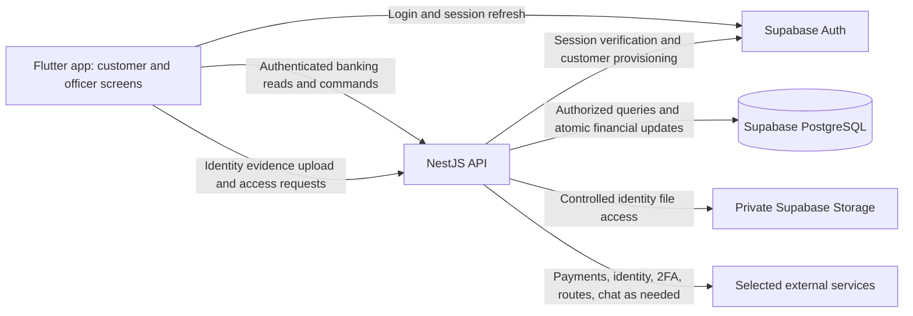
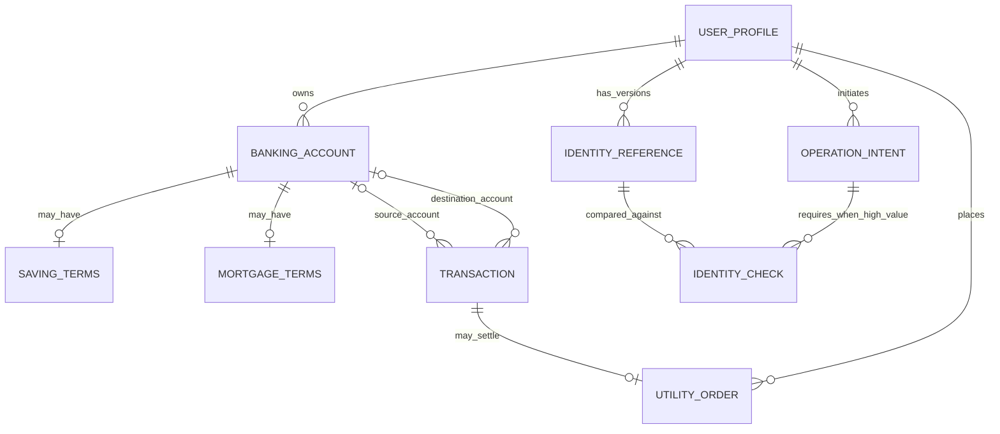

# Design and technology decisions

Status: private reference enrollment/status and officer acceptance/correction extend the first customer flow on 2026-10-27. Flutter + NestJS + Supabase is confirmed. The local customer foundation includes officer provisioning, an initial checking account, customer contact edits and requested officer edits. [docs/REFERENCE_FLOW.md](docs/REFERENCE_FLOW.md) records the implemented reference boundary and verification limits. Later high-value comparison and transaction 2FA remain unimplemented; AWS remains undecided. Financial flows and much of the schema below remain proposals; no cloud services are deployed. The assignment requirements are recorded in [REQUIREMENTS.md](REQUIREMENTS.md).

Scope boundary: [SCOPE.md](SCOPE.md) records the detailed PDF/rubric audit. The mechanisms and schemas below are candidates for implementation, not extra assignment features. Use the smallest design that demonstrates the required outcomes reliably.

## Goal and scope

Build a coherent Android banking project for a team of 2-3 students, covering all required feature groups and producing enough design and implementation evidence for the report and demo.

Use synthetic identities and balances during development. External services should start in test/sandbox environments. Any simulated interbank, billing, booking, or identity-verification behavior needs an explicit description and lecturer agreement before being counted as complete.

## Confirmed technology stack

Source audit: the brief requires Android, database persistence, eKYC, transaction 2FA, and Google Play delivery. Cloud database hosting is preferred, and Firebase is an example. It does not mandate serverless, a separate backend, Kotlin, Flutter, NestJS, PostgreSQL, an LLM provider, or specific identity/payment products. See [REQUIREMENTS.md](REQUIREMENTS.md) for page/item references. Android/iOS flexibility and easier future upgrades are the user's additional design goals.

The user selected the following stack on 2026-10-13. This replaces the earlier Kotlin/Compose and Firebase proposals.

| Area | Selected technology | Responsibility and boundary |
| --- | --- | --- |
| Mobile app | Flutter / Dart | One customer/officer app. Deliver Android for the assignment while preserving future iOS compatibility. |
| Backend | NestJS / TypeScript | One API for banking reads/writes, role/ownership checks, account creation, transaction 2FA, calculations, and integrations. |
| Database | PostgreSQL hosted on Supabase | Relational application records, constraints, and atomic local financial updates. |
| Authentication | Supabase Auth | Login and sessions for both roles. eKYC and transaction-bound 2FA remain separate application responsibilities. |
| Identity files | Private Supabase Storage | Identity evidence with controlled access; metadata, ownership, and verification results in PostgreSQL. |

Use one mobile app, one backend application, and one application database. Supabase supplies managed database/authentication/storage services; NestJS is the chosen place for application business logic. A separate Supabase Edge Functions backend is not part of this design.

### Rationale and accepted trade-offs

| Decision | Why it fits Nene | Cost or limitation |
| --- | --- | --- |
| Flutter | Shared application code supports the user's Android/iOS goal and the many required role/account/service screens (BR-01 to BR-14, TR-02). | Dart and Flutter need to be learned; camera, identity, payment, and location plugins need compatibility checks and platform testing. |
| NestJS | Keeps authorization, financial rules, provider callbacks, and calculations together in ordinary TypeScript modules (BR-01 to BR-12). | An additional deployment, configuration, and maintenance responsibility; the team needs a backend owner. A separate server is a chosen trade-off, not a PDF requirement. |
| PostgreSQL | Explicit account/customer/transaction relationships support data integrity and the required ER explanation (TR-03, TR-05). Transactions support all-or-nothing local updates. | Migrations, constraints, concurrency handling, and query design still need implementation. Transactions alone do not prevent every race or duplicate request. |
| Supabase managed services | Reduces infrastructure work for persistence, login, and private evidence storage (BR-03, TR-03). | Service limits, availability, and costs need checking. Moving Auth/Storage providers still requires migration work even though the database is PostgreSQL. |

Keep Flutter screens separate from data access, use a stable API contract, keep database migrations in source control, and isolate external integrations in small backend services. These boundaries support maintenance and future changes without adding a general provider framework. Replacing the mobile framework would still require frontend work.

Android is the submission platform. An iOS release is not added to the deadline scope; it would require platform testing and macOS/Xcode build access. Technology selection does not add feature marks or relax any of the seven business groups.

### Foundation choices and remaining decisions

| Area | Proposed treatment / unresolved choice |
| --- | --- |
| Flutter organization | Built-in ChangeNotifier manages sessions and the first customer workflow; repositories isolate Supabase Auth and HTTP access from widgets. Protected pages remain inside the authenticated workspace. No state-management or routing package is needed for this flow. |
| Database access | NestJS uses `pg` and parameterized SQL. A restricted role has explicit column grants for customer/account creation and contact/name edits, with SQL transactions. It cannot write roles, profile status or balances. SQL migrations own the schema. No ORM is introduced. |
| Backend hosting and development | Local Supabase runs through its pinned CLI and Docker. NestJS runs on Node.js 24. Cloud hosting, Supabase project provisioning, and paid plans remain undecided. |
| Identity and second factor | Build officer-assisted private reference enrollment first; later perform actual server-side one-to-one face comparison for high-value activity. Reference acceptance is not a completed identity check. Matching implementation/provider, threshold and transaction-2FA mechanism remain open. AWS has no priority; [options research](docs/IDENTITY_OPTIONS.md) is background only. No mandatory liveness SDK or native bridge. OTP remains a candidate, not a confirmed channel. |
| Payments and other external services | Select one payment integration after checking access and course expectations; VNPay and Stripe are examples. Separately resolve interbank, biller, and purchase/booking fulfillment. |
| Maps and routes | Choose a compatible map SDK and walking-route service. Pins or straight-line distances alone do not demonstrate the required route. |
| Chatbot | Choose a mechanism for intelligent answers and allowlisted activity links. An LLM/provider is not selected or required by name; secret-bearing calls belong in NestJS. |

Dependencies are pinned in lockfiles after compatibility checks; see [docs/SETUP.md](docs/SETUP.md). Resolve remaining provider, account, and release choices when needed. Local setup does not authorize cloud account creation, billing, or publication.

### Implemented base and its limits

- The app uses Supabase email/password login with memory-only sessions. It calls `GET /api/v1/me` with the access token and opens the customer or officer workspace using the returned server role. No public signup or role selection is exposed.
- NestJS validates the token through Supabase Auth, then queries the active profile by the verified subject. Roles come from PostgreSQL, never client-editable auth metadata. All API routes require authentication except the explicit liveness endpoint.
- `bank.user_profiles` stores the Auth ID, display name, server role/status, contact fields and timestamps. RLS and grants deny client-facing database roles. The backend role has narrow customer creation/edit privileges; role/status remain protected. The `bank` schema is excluded from the data API.
- The private `identity-evidence` bucket allows JPEG/PNG up to 10 MiB. Client roles cannot access its files. Upload, ownership, identity review, and eKYC verification are future work.
- Local setup generates ignored configuration and a random restricted database password. Automated integration checks create and remove synthetic fixtures. Initial officer identities require trusted local administration; the customer endpoint cannot create officers.
- [The first customer flow](docs/CUSTOMER_FLOW.md) reserves customer/account UUIDs before calling local Auth, reconciles uncertain creation by UUID, and commits the profile/account together. Customers edit their own phone/address; officers edit customer name/contact fields with a request reason. Edits append the actor, customer, submitted field names and time, plus the officer's reason. VND/checking/zero are first-demo choices, not PDF requirements.
- Ordinary background/resume and same-user token refresh retain pending creation details while revalidating the profile. Sign-out, confirmed expiry/access denial, or a changed identity/role clears the protected workspace. A process restart loses the memory-only draft and request key; recovery limits are documented in [docs/CUSTOMER_FLOW.md](docs/CUSTOMER_FLOW.md).

This provides a local BR-01/BR-02 flow and partial BR-03/BR-05/TR-03 support. It does not complete identity verification or account-management scope. See [docs/API.md](docs/API.md) for current endpoints and [docs/SETUP.md](docs/SETUP.md) for verification evidence.

### Google Play status

On 2026-10-13, the user reported having a Google console account and awaiting identity verification. This is understood to mean Google Play Console; it has not been inspected directly. Local application development can proceed while account verification is pending.

Account type and creation date remain unknown. For personal accounts created after November 13, 2023, Google's [production-access requirements](https://support.google.com/googleplay/android-developer/answer/14151465?hl=en) include a closed test with at least 12 testers continuously opted in for 14 days, followed by an application for production access. Identity verification alone does not establish publication readiness. Confirm applicability when scheduling release work.

## Component boundaries

The following is the target component arrangement. Flutter/Auth, customer/profile/account access, local officer provisioning, PostgreSQL and backend-authorized private reference-file transfer are implemented. Financial operations, hosted activation and external-provider arrows remain future work. The mobile app has no direct table access.



NestJS verifies the Supabase access token and loads the active role from server-controlled records. Future sensitive operations must check account ownership, input, applicable identity requirements, and explicit officer permissions. Customer/officer application roles are distinct from Supabase database roles. Future customer APIs must not permit granting officer roles, setting balances/rates, or approving identity checks.

Keep banking tables out of client-accessible Supabase data APIs using schema exposure and database grants/policies appropriate to the final configuration. Do not rely on the Flutter UI to enforce this boundary. Use minimal database privileges for NestJS; privileged SDK/database connections still require explicit application authorization, including where they bypass row-level security.

Supabase Auth handles login/session management; it does not automatically satisfy eKYC, officer-assisted verification, or transaction-bound 2FA. Implemented local customer provisioning uses backend-only administrative access after the authenticated officer's permissions are checked. Hosted activation remains to design. Keep database credentials and Supabase secret/service credentials out of Flutter and source control.

Private reference upload/preview now passes through NestJS after ownership/role checks. PostgreSQL retains case, immutable evidence/name revisions, review decisions and retry metadata; direct client Storage access stays denied. Actual face comparison remains unimplemented. [docs/REFERENCE_FLOW.md](docs/REFERENCE_FLOW.md) records the implemented boundary supporting BR-03; this adds no document-management product or client-controlled verification outcome.

## Roles and primary flows

| Role | Proposed interface and responsibilities |
| --- | --- |
| Customer | Home overview, account details/history, transfer, deposit/withdrawal, utilities, branch map, chatbot, profile/identity settings. |
| Officer | Customer search/detail, customer and banking-account creation, requested profile updates, identity enrollment/review, saving-rate management. |

Use one app with role-based navigation unless course guidance requires separate apps. Separate the authentication identity from a banking account: one customer can own several banking accounts.

Proposed customer navigation: Home, Accounts, Services, Assistant, Profile. Branch navigation is available from Home/Services. Show account-specific saving or mortgage information within account details. Keep the officer workspace distinct and make customer changes auditable.

[docs/SCREEN_MAP.md](docs/SCREEN_MAP.md) expands this proposal into requirement-linked destinations, customer/officer journeys and state handling. Proposed officer navigation is Workspace, Customers, Rates, Profile. [docs/UI_DIRECTION.md](docs/UI_DIRECTION.md) contains the sign-in, customer home and officer workspace study requested on 2026-10-19. Its HTML remains an isolated design artifact. Flutter separately implements the first customer/account workflow described in [docs/CUSTOMER_FLOW.md](docs/CUSTOMER_FLOW.md); the wider financial navigation remains planned.

Proposed financial flow: input -> review -> high-value identity check when required -> chosen 2FA -> backend result -> receipt/history. OTP is a candidate mechanism. Show amount, currency, recipient/provider, fees if applicable, and total before authorization. Handle loading, empty, error, permission-denied, cancellation, and uncertain network outcomes explicitly. On an uncertain outcome, look up the existing operation instead of submitting a new debit.

The user selected the Open pocket logo direction on 2026-10-19 and approved the lighter palette for both logo and UI. Flutter now uses soft teal (`#4C929E`), light apricot (`#F6C9A5`), ivory (`#F8F7F2`) and darker action teal (`#286E78`) for readable controls. Its wallet silhouette represents everyday money in one place; the open fold and apricot detail express visibility and focus. [docs/BRANDING.md](docs/BRANDING.md) records the reference, approved palette, Flutter painter and Android icon integration. A wallet-shaped logo does not narrow the banking assignment to an e-wallet product or add card-issuing features.

The approved lighter direction is applied to Flutter sign-in, loading/error states, own profile/checking-account display, customer contact edits, officer creation/search/detail/requested edits and reference capture/review, using platform typography. The study's saving/mortgage summaries, transaction lists, financial controls and rates remain planned. Color measurements and verification limits are recorded in [docs/UI_DIRECTION.md](docs/UI_DIRECTION.md); Flutter checks and historical emulator evidence are in [docs/SETUP.md](docs/SETUP.md). Current interactive review uses the user-started Edge demo. The priorities are readable amounts, clear account types, consistent controls, accessible labels, and predictable confirmation flows. Final custom typography, iOS icons and a full accessibility/release asset review remain open.

## Transaction and identity design

[docs/TRANSACTION_FLOW.md](docs/TRANSACTION_FLOW.md) maps the planned shared S02–S05 review/identity/2FA/result flow to BR-03/BR-04/BR-08–BR-12, with state/recovery rules and candidate endpoints. The user requested this planning step on 2026-10-27; it adds no runtime behavior. It recommends evaluating existing Supabase authenticator TOTP, subject to operation-binding, successful-code replay and uncertain-result tests. This is not a confirmed factor choice or permission to treat login `aal2` as transaction authorization.

The subsequent [isolated TOTP experiment](docs/TOTP_COMPATIBILITY.md) confirms provider enrollment/verification and observes successful-code reuse across challenges plus concurrent reuse of one challenge. Supabase MFA alone therefore does not satisfy the transaction plan. The [backend safeguards prototype](docs/AUTHORIZATION_PROTOTYPE.md) now demonstrates operation binding, PostgreSQL proof reservation, replay/recovery and one-time synthetic consumption across two service instances. It is unregistered in `AppModule`, uses a disposable schema and has no balance writes or customer routes. Normal demo MFA stays disabled.

The [customer authenticator lifecycle plan](docs/AUTHENTICATOR_LIFECYCLE.md) maps Profile setup, old-factor replacement, proposed provider-native recovery codes and the Auth session handoff. Recovery permits replacing a factor only; it cannot approve a transaction or grant officers reset powers. One server-owned active-factor/security-revision binding protects management and financial authorization. Tokens and setup/backup secrets remain transient. Before integration, prove fresh-password evidence, recovery-code behavior and a guarded Flutter handoff across logout, refresh and browser tabs. The pinned SDK broadcasts sessions even without persistence, so a second client is not automatically isolated. The plan does not finalize the factor choice or add runtime behavior.

[docs/IDENTITY_VERIFICATION.md](docs/IDENTITY_VERIFICATION.md) records the minimum direction: customer/officer reference capture and private submission, officer acceptance or correction, then actual server-side one-to-one comparison for later high-value activity. C16/O06 now implement the reference foundation and show **Reference accepted**, not **Identity verified**. [docs/REFERENCE_FLOW.md](docs/REFERENCE_FLOW.md) records its endpoints, narrow database grants, local notice/retention defaults and test limits. This milestone does not complete BR-03; a real operation-bound comparison and the agreed eKYC interpretation still need demonstration.

Enrollment does not depend on an electronic matcher or liveness provider. The reference foundation uses an explicit coursework notice/acknowledgement, officer association confirmation, seven-day access expiry and maintenance-driven physical deletion. Select the comparison implementation when adding the high-value check. AWS, advanced liveness, document OCR/NFC and commercial KYC remain undecided or optional for a concrete need; no provider-specific native bridge is the next task. The user has not waived eKYC, high-value checks or transaction 2FA.

Requesting a new camera photo does not prove live presence or defeat image injection/replay. Reference association and ordinary face comparison do not authenticate a government identity document. Record these limits and clarify the lecturer's expected eKYC depth/officer-subject coverage before claiming full acceptance. The [provider comparison](docs/IDENTITY_OPTIONS.md) retains research without a preferred vendor.

The brief requires eKYC and transaction 2FA. The following flow proposes OTP as the second factor. Its face-photo example informs high-value verification but does not prescribe a face algorithm or liveness vendor. A different chosen mechanism must still satisfy the identity and 2FA requirements.

1. The authenticated client submits an operation intent with an idempotency key. The server validates ownership, recipient, amount, account rules, and available funds.
2. If the operation meets the server-owned high-value rule, request a new capture and perform actual one-to-one face comparison with the customer's accepted reference. Bind the result to the user, reference/profile revision, exact operation and expiry. Missing, failed or unavailable comparison cannot authorize posting; reference acceptance cannot substitute for it.
3. Every financial operation, including one below the high-value threshold, passes transaction-bound 2FA. If OTP is selected, bind its short-lived challenge to the user and exact operation details, with server-enforced delivery, expiry, attempt limits and reuse protection. Editing the amount or recipient invalidates prior authorizations.
4. After verification, NestJS rechecks the financial preconditions and uses one PostgreSQL transaction to record the financial transaction, balance changes, and challenge consumption, plus any ledger entries used by the chosen record design. Apply appropriate locking/conditional updates and uniqueness constraints to handle concurrent and repeated operations.
5. A repeated request returns the existing operation result. It does not post another transaction.

Pre-authorization intent/challenge metadata is separate from financial transaction records. No posted financial transaction or balance mutation occurs before required 2FA; confirm the lecturer's interpretation of the brief's persistence wording before implementing persistent drafts.

For an external provider, authorize first, then submit using a stable operation identifier. A signed, deduplicated provider result determines settlement. Provider cancellation/failure must not become a completed payment. Define reservation, settlement, release, timeout, and reconciliation behavior before implementing external debits; the local database and provider are not one atomic system.

Use integer minor units and an explicit currency; the first demo creates VND accounts. Choose a transaction-record design that keeps balances and history consistent. A balanced-entry ledger, immutable journal, compensating reversals, and internal clearing accounts are possible mechanisms if needed by the chosen flows; they are not independent grading requirements or a reason to build a general accounting product. Define permitted deposit/withdrawal behavior for saving and mortgage accounts before implementation.

## Initial data model

The following is a conceptual PostgreSQL model, not a finished schema. Use explicit foreign keys, uniqueness/check constraints, and migrations for the final tables. Link application profiles to Supabase Auth identities without storing passwords in application tables. Separate entities such as LedgerEntry, AuditEvent, persisted ChatSession/ChatMessage, and a materialized RepaymentSchedule are optional modeling choices. The assignment requires the corresponding outcomes where stated, not each proposed table. Retain only entities the selected flows need.

| Entity | Main fields and relationships |
| --- | --- |
| UserProfile | Supabase Auth user ID, application role, name, contact fields, status; linked customer accounts. Implemented permissions allow own phone/address edits and officer-requested name/contact edits; email, role and status remain protected. |
| IdentityReference / IdentityCheck | Keep the accepted photo/profile revision and officer review separate from later actual operation-bound comparison results; see [the minimum identity map](docs/IDENTITY_VERIFICATION.md). A review decision records a reference association, not an electronic pass. |
| BankingAccount | Owner ID, account number, type, currency, balance, status. Model internal settlement accounts only if the chosen external flow needs them. |
| SavingTerms | Account ID, rate/policy reference, principal, effective dates, term and profit calculation convention. |
| InterestRatePolicy | Officer-managed rate, applicability, effective dates, change history. |
| MortgageTerms | Account ID, principal, rate convention, term, repayment frequency, outstanding amount. |
| RepaymentSchedule | Mortgage account ID, due dates, principal/interest components, amount due, payment status. |
| OperationIntent / TransactionChallenge | User ID, bound operation details, idempotency key, expiry, attempt count, consumed status; protected verification material for the selected second factor. Not a posted transaction. OTP-specific fields apply only if OTP is selected. |
| Transaction | Authorized operation ID, type, amount, currency, participating account references, status, server timestamps, provider reference where relevant. |
| LedgerEntry (optional) | Transaction ID, account ID, debit/credit amount and currency; immutable posting if needed by the record design. |
| UtilityOrder | Customer, category, bill/customer/phone/product references, quoted amount, provider outcome, transaction ID. |
| BankBranch | Name, address, coordinates, opening information as available. |
| AuditEvent | Actor, action, entity ID, server timestamp, appropriately minimized change metadata. |
| ChatSession / ChatMessage | Owner, message content, timestamps, allowlisted action descriptors; retention and financial-context access remain open. |

The sketch below shows core relationships only; optional ledger, chat-history, and materialized schedule tables are excluded until justified by implementation needs.



Source/destination account references can be absent for an external side of an operation; validate which references are required for each transaction type. The diagram is not a completed schema.

Before implementing each remaining flow, define exact PostgreSQL fields/types, required/optional values, foreign keys, uniqueness, ownership rules, query/index needs, state transitions, and retention rules. The migrations now define profiles, initial accounts, creation requests and edit audits; their implemented relationships are recorded in [docs/CUSTOMER_FLOW.md](docs/CUSTOMER_FLOW.md). Complete the remaining class and use-case diagrams as responsibilities are agreed. This larger conceptual sketch does not fulfill the entire report requirement.

Savings profit and mortgage repayment calculations need explicit policies: rate unit, accrual convention, rounding, rate-change behavior, repayment formula, and due-date handling. Do not invent these as if the assignment specified them.

## Integration boundaries

- Payments: one real sandbox integration with callback verification. Confirm access before committing to a provider.
- Interbank transfers: separate adapter and explicit real/simulated status. A successful payment checkout does not prove interbank transfer support.
- Bills, top-ups, and purchases/bookings: deterministic fixtures can support early development; external fulfillment remains a distinct requirement/lecturer decision.
- Maps: store branch data in the database and request walking routes over a supported network. Define whether “nearest” means walking distance or geographic distance; propose shortest walking distance among reachable candidate branches. Handle missing routes and denied location access.
- Chatbot: authorize reads for the current user, minimize context, and return only validated app actions such as opening bills, phone top-up, or a month-filtered history screen. A payment action always opens the ordinary review and chosen 2FA flow.

## Delivery roadmap

[ROADMAP.md](ROADMAP.md) records the remaining work, dependencies, and immediate next feature flow. The internal submission target remains 29 November, with 30 November as contingency before the portal deadline at the start of 1 December. Planning uses Asia/Bangkok provisionally because the screenshot does not specify its timezone.

The local customer/account and reference-enrollment flows are implemented. Transaction confirmation/2FA and the customer authenticator lifecycle are planned, provider TOTP compatibility has been probed and backend safeguards have been demonstrated in an isolated prototype. Next run the bounded session-handoff/recovery-code probe, then integrate the proven customer security flow and reviewed policies. Review the reference slice in the user-started Edge demo alongside that work. Actual server-side face comparison for high-value activity and transaction-bound 2FA must exist before financial posting; AWS remains undecided. Build the remaining account types, secure transactions, external services, branch navigation and activity-linked chat on that foundation. Hosted customer activation also remains open. Report evidence and Google Play preparation proceed alongside feature development.

## Repository layout

```text
app/                  Flutter/Dart mobile application
backend/              Single NestJS/TypeScript API and integration services
infrastructure/       PostgreSQL migrations and Supabase access/storage configuration
scripts/              Local setup and integration verification
docs/                 Detailed diagrams, report material, demo checklist
SCOPE.md              Detailed source audit and scope boundaries
AGENTS.md             Workspace collaboration and engineering instructions
DESIGN.md             Architecture and decision record
REQUIREMENTS.md        Source requirements, rubric, acceptance evidence
README.md             Setup and project entry point
```

These directories contain the base implementation. Setup and verification commands are in [docs/SETUP.md](docs/SETUP.md). The ignored `.tools/` directory may hold the local Flutter SDK; it is not application source.

## References for the selected stack and proposed architecture

Reviewed during stack selection and the 2026-10-15 setup. These inform implementation choices and do not override the course brief. Local verification is recorded separately; cloud deployment access and external provider compatibility remain unverified.

- [Flutter architecture](https://docs.flutter.dev/app-architecture/guide): UI/data separation, repositories, services, and an optional domain layer.
- [Flutter iOS release requirements](https://docs.flutter.dev/deployment/ios): macOS/Xcode build requirements for future iOS delivery.
- [NestJS documentation](https://docs.nestjs.com/): the TypeScript backend framework.
- [Supabase PostgreSQL](https://supabase.com/docs/guides/database/overview): managed relational database and access controls.
- [PostgreSQL transactions](https://www.postgresql.org/docs/current/tutorial-transactions.html): atomic local database operations.
- [Supabase Auth](https://supabase.com/docs/guides/auth) and [JWT verification](https://supabase.com/docs/guides/auth/jwts): sessions and authenticated identity verification.
- [Supabase private Storage](https://supabase.com/docs/guides/storage/buckets/fundamentals): controlled access to stored files.
