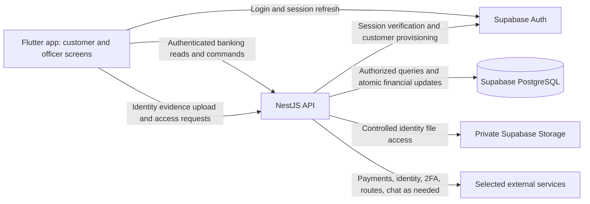
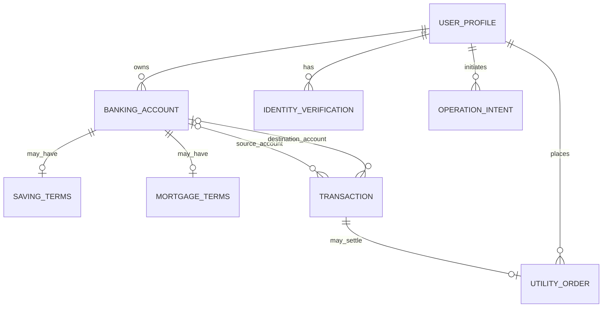

# Design and technology decisions

Status: updated 2026-10-19. Flutter + NestJS + Supabase is confirmed and the local foundation is implemented. The base includes sign-in, a server-authorized profile, a profile migration, and private storage configuration. Financial flows and the larger schema below remain proposals; no cloud services are deployed. The assignment requirements are recorded in [REQUIREMENTS.md](REQUIREMENTS.md).

Scope boundary: [SCOPE.md](SCOPE.md) records the detailed PDF/rubric audit. The mechanisms and schemas below are candidates for implementation, not extra assignment features. Use the smallest design that demonstrates the required outcomes reliably.

## Goal and scope

Build a coherent Android banking project for a team of 2-3 students, covering all required feature groups and producing enough design and implementation evidence for the report and demo.

Use synthetic identities and balances during development. External services should start in test/sandbox environments. Any simulated interbank, billing, booking, or identity-verification behavior needs an explicit description and lecturer agreement before being counted as complete.

## Confirmed technology stack

Source audit: the brief requires Android, database persistence, eKYC, transaction 2FA, and Google Play delivery. Cloud database hosting is preferred, and Firebase is an example. It does not mandate serverless, a separate backend, Kotlin, Flutter, NestJS, PostgreSQL, an LLM provider, or specific identity/payment products. See [REQUIREMENTS.md](REQUIREMENTS.md) for page/item references. Android/iOS flexibility and easier future upgrades are the user's additional design goals.

The user selected the following stack on 2026-10-13. This replaces the earlier Kotlin/Compose and Firebase proposals.

| Area | Selected technology | Responsibility and boundary |
| --- | --- | --- |
| Mobile app | Flutter / Dart | One customer/officer app. Deliver Android for the assignment while preserving future iOS compatibility. |
| Backend | NestJS / TypeScript | One API for banking reads/writes, role/ownership checks, account creation, transaction 2FA, calculations, and integrations. |
| Database | PostgreSQL hosted on Supabase | Relational application records, constraints, and atomic local financial updates. |
| Authentication | Supabase Auth | Login and sessions for both roles. eKYC and transaction-bound 2FA remain separate application responsibilities. |
| Identity files | Private Supabase Storage | Identity evidence with controlled access; metadata, ownership, and verification results in PostgreSQL. |

Use one mobile app, one backend application, and one application database. Supabase supplies managed database/authentication/storage services; NestJS is the chosen place for application business logic. A separate Supabase Edge Functions backend is not part of this design.

### Rationale and accepted trade-offs

| Decision | Why it fits Nene | Cost or limitation |
| --- | --- | --- |
| Flutter | Shared application code supports the user's Android/iOS goal and the many required role/account/service screens (BR-01 to BR-14, TR-02). | Dart and Flutter need to be learned; camera, identity, payment, and location plugins need compatibility checks and platform testing. |
| NestJS | Keeps authorization, financial rules, provider callbacks, and calculations together in ordinary TypeScript modules (BR-01 to BR-12). | An additional deployment, configuration, and maintenance responsibility; the team needs a backend owner. A separate server is a chosen trade-off, not a PDF requirement. |
| PostgreSQL | Explicit account/customer/transaction relationships support data integrity and the required ER explanation (TR-03, TR-05). Transactions support all-or-nothing local updates. | Migrations, constraints, concurrency handling, and query design still need implementation. Transactions alone do not prevent every race or duplicate request. |
| Supabase managed services | Reduces infrastructure work for persistence, login, and private evidence storage (BR-03, TR-03). | Service limits, availability, and costs need checking. Moving Auth/Storage providers still requires migration work even though the database is PostgreSQL. |

Keep Flutter screens separate from data access, use a stable API contract, keep database migrations in source control, and isolate external integrations in small backend services. These boundaries support maintenance and future changes without adding a general provider framework. Replacing the mobile framework would still require frontend work.

Android is the submission platform. An iOS release is not added to the deadline scope; it would require platform testing and macOS/Xcode build access. Technology selection does not add feature marks or relax any of the seven business groups.

### Foundation choices and remaining decisions

| Area | Proposed treatment / unresolved choice |
| --- | --- |
| Flutter organization | Built-in ChangeNotifier manages the small session flow; repositories isolate Supabase Auth and HTTP access from widgets. No state-management or routing package is needed for the base. |
| Database access | NestJS uses `pg` and parameterized SQL. A restricted role can read `bank.user_profiles`; future writes need explicit privileges and transactions. SQL migrations own the schema. No ORM is introduced. |
| Backend hosting and development | Local Supabase runs through its pinned CLI and Docker. NestJS runs on Node.js 24. Cloud hosting, Supabase project provisioning, and paid plans remain undecided. |
| Identity and second factor | Choose the eKYC/high-value verification method and transaction 2FA mechanism. OTP is a proposal, not a confirmed channel or provider. |
| Payments and other external services | Select one payment integration after checking access and course expectations; VNPay and Stripe are examples. Separately resolve interbank, biller, and purchase/booking fulfillment. |
| Maps and routes | Choose a compatible map SDK and walking-route service. Pins or straight-line distances alone do not demonstrate the required route. |
| Chatbot | Choose a mechanism for intelligent answers and allowlisted activity links. An LLM/provider is not selected or required by name; secret-bearing calls belong in NestJS. |

Dependencies are pinned in lockfiles after compatibility checks; see [docs/SETUP.md](docs/SETUP.md). Resolve remaining provider, account, and release choices when needed. Local setup does not authorize cloud account creation, billing, or publication.

### Implemented base and its limits

- The app uses Supabase email/password login with memory-only sessions. It calls `GET /api/v1/me` with the access token and displays the returned profile. No public signup or role selection is exposed.
- NestJS validates the token through Supabase Auth, then queries the active profile by the verified subject. Roles come from PostgreSQL, never client-editable auth metadata. All API routes require authentication except the explicit liveness endpoint.
- `bank.user_profiles` stores the Auth ID, display name, customer/officer role, active/disabled status, and timestamps. RLS and grants deny client-facing database roles; the backend role has SELECT only. The `bank` schema is excluded from the data API.
- The private `identity-evidence` bucket allows JPEG/PNG up to 10 MiB. Client roles cannot access its files. Upload, ownership, identity review, and eKYC verification are future work.
- Local setup generates ignored configuration and a random restricted database password. Automated integration checks create and remove one synthetic identity. Persistent demo provisioning and officer account creation remain separate work.

This foundation supports BR-01/BR-03 and TR-03. It does not complete them. See [docs/API.md](docs/API.md) for current endpoints and [docs/SETUP.md](docs/SETUP.md) for verification evidence.

### Google Play status

On 2026-10-13, the user reported having a Google console account and awaiting identity verification. This is understood to mean Google Play Console; it has not been inspected directly. Local application development can proceed while account verification is pending.

Account type and creation date remain unknown. For personal accounts created after November 13, 2023, Google's [production-access requirements](https://support.google.com/googleplay/android-developer/answer/14151465?hl=en) include a closed test with at least 12 testers continuously opted in for 14 days, followed by an application for production access. Identity verification alone does not establish publication readiness. Confirm applicability when scheduling release work.

## Component boundaries

The following is the target component arrangement. Flutter/Auth, authenticated NestJS profile reads, and PostgreSQL are implemented locally. Financial operations, provisioning, file transfer, and external-provider arrows remain future work. The mobile app has no direct table access.



NestJS verifies the Supabase access token and loads the active role from server-controlled records. Future sensitive operations must check account ownership, input, applicable identity requirements, and explicit officer permissions. Customer/officer application roles are distinct from Supabase database roles. Future customer APIs must not permit granting officer roles, setting balances/rates, or approving identity checks.

Keep banking tables out of client-accessible Supabase data APIs using schema exposure and database grants/policies appropriate to the final configuration. Do not rely on the Flutter UI to enforce this boundary. Use minimal database privileges for NestJS; privileged SDK/database connections still require explicit application authorization, including where they bypass row-level security.

Supabase Auth handles login/session management; it does not automatically satisfy eKYC, officer-assisted verification, or transaction-bound 2FA. Future officer customer provisioning must use backend-only administrative access with the authenticated officer's permissions checked first. Keep database credentials and Supabase secret/service credentials out of Flutter and source control.

The private identity bucket is prepared; file upload and verification flows are not implemented. The initial proposal routes file operations through NestJS after ownership/role checks. A narrowly scoped, short-lived direct upload/download may be added if needed, with authorization still controlled by the backend; it must not allow the client to set its verification result. Persist evidence references and verification metadata in PostgreSQL when implementing this flow. This is the selected storage approach supporting BR-03, not an extra document-management feature.

## Roles and primary flows

| Role | Proposed interface and responsibilities |
| --- | --- |
| Customer | Home overview, account details/history, transfer, deposit/withdrawal, utilities, branch map, chatbot, profile/identity settings. |
| Officer | Customer search/detail, customer and banking-account creation, requested profile updates, identity enrollment/review, saving-rate management. |

Use one app with role-based navigation unless course guidance requires separate apps. Separate the authentication identity from a banking account: one customer can own several banking accounts.

Proposed customer navigation: Home, Accounts, Services, Assistant, Profile. Branch navigation is available from Home/Services. Show account-specific saving or mortgage information within account details. Keep the officer workspace distinct and make customer changes auditable.

[docs/SCREEN_MAP.md](docs/SCREEN_MAP.md) expands this proposal into requirement-linked destinations, customer/officer journeys and state handling. Proposed officer navigation is Workspace, Customers, Rates, Profile. [docs/UI_DIRECTION.md](docs/UI_DIRECTION.md) contains the sign-in, customer home and officer workspace study requested on 2026-10-19. These are local design artifacts, not app implementation or a separate web product.

Proposed financial flow: input -> review -> chosen 2FA -> backend result -> receipt/history. OTP is a candidate mechanism. Show amount, currency, recipient/provider, fees if applicable, and total before authorization. Handle loading, empty, error, permission-denied, cancellation, and uncertain network outcomes explicitly. On an uncertain outcome, look up the existing operation instead of submitting a new debit.

The user selected the Open pocket logo direction on 2026-10-19 and approved the lighter palette for both logo and UI. Flutter now uses soft teal (`#4C929E`), light apricot (`#F6C9A5`), ivory (`#F8F7F2`) and darker action teal (`#286E78`) for readable controls. Its wallet silhouette represents everyday money in one place; the open fold and apricot detail express visibility and focus. [docs/BRANDING.md](docs/BRANDING.md) records the reference, approved palette, Flutter painter and Android icon integration. A wallet-shaped logo does not narrow the banking assignment to an e-wallet product or add card-issuing features.

The approved lighter direction is applied to the existing Flutter sign-in, loading/error and server-provided profile screens, using platform typography. Full customer home and officer workspace business layouts remain design studies. Color measurements and verification limits are recorded in [docs/UI_DIRECTION.md](docs/UI_DIRECTION.md); Flutter checks and emulator evidence are in [docs/SETUP.md](docs/SETUP.md). The priorities are readable amounts, clear account types, consistent controls, accessible labels, and predictable confirmation flows. Final custom typography, iOS icons and a full accessibility/release asset review remain open.

## Transaction and identity design

The brief requires eKYC and transaction 2FA. The following flow proposes OTP as the second factor. Its face-photo example informs high-value verification but does not prescribe a face algorithm or liveness vendor. A different chosen mechanism must still satisfy the identity and 2FA requirements.

1. The authenticated client submits an operation intent with an idempotency key. The server validates ownership, recipient, amount, account rules, and available funds.
2. The server binds a short-lived OTP challenge to the user and exact operation details. Editing the amount or recipient invalidates the authorization. Delivery, expiry, retry limits, and replay protection are enforced by the backend.
3. If the operation exceeds the agreed threshold, the chosen high-value identity verification must also succeed. If we choose face-based verification, camera capture or officer enrollment review alone does not demonstrate a later identity match. Document the actual method and distinguish implemented checks from any simulated behavior.
4. After verification, NestJS rechecks the financial preconditions and uses one PostgreSQL transaction to record the financial transaction, balance changes, and challenge consumption, plus any ledger entries used by the chosen record design. Apply appropriate locking/conditional updates and uniqueness constraints to handle concurrent and repeated operations.
5. A repeated request returns the existing operation result. It does not post another transaction.

Pre-authorization intent/challenge metadata is separate from financial transaction records. No posted financial transaction or balance mutation occurs before required 2FA; confirm the lecturer's interpretation of the brief's persistence wording before implementing persistent drafts.

For an external provider, authorize first, then submit using a stable operation identifier. A signed, deduplicated provider result determines settlement. Provider cancellation/failure must not become a completed payment. Define reservation, settlement, release, timeout, and reconciliation behavior before implementing external debits; the local database and provider are not one atomic system.

Use integer minor units and an explicit currency; VND-only is a proposal. Choose a transaction-record design that keeps balances and history consistent. A balanced-entry ledger, immutable journal, compensating reversals, and internal clearing accounts are possible mechanisms if needed by the chosen flows; they are not independent grading requirements or a reason to build a general accounting product. Define permitted deposit/withdrawal behavior for saving and mortgage accounts before implementation.

## Initial data model

The following is a conceptual PostgreSQL model, not a finished schema. Use explicit foreign keys, uniqueness/check constraints, and migrations for the final tables. Link application profiles to Supabase Auth identities without storing passwords in application tables. Separate entities such as LedgerEntry, AuditEvent, persisted ChatSession/ChatMessage, and a materialized RepaymentSchedule are optional modeling choices. The assignment requires the corresponding outcomes where stated, not each proposed table. Retain only entities the selected flows need.

| Entity | Main fields and relationships |
| --- | --- |
| UserProfile | Supabase Auth user ID, application role, name, contact fields, status; linked customer accounts. Editable fields and officer permissions need explicit rules. |
| IdentityVerification | User ID, private evidence references, enrollment/review status, reviewing officer, timestamps, method/results for high-value verification. |
| BankingAccount | Owner ID, account number, type, currency, balance, status. Model internal settlement accounts only if the chosen external flow needs them. |
| SavingTerms | Account ID, rate/policy reference, principal, effective dates, term and profit calculation convention. |
| InterestRatePolicy | Officer-managed rate, applicability, effective dates, change history. |
| MortgageTerms | Account ID, principal, rate convention, term, repayment frequency, outstanding amount. |
| RepaymentSchedule | Mortgage account ID, due dates, principal/interest components, amount due, payment status. |
| OperationIntent / TransactionChallenge | User ID, bound operation details, idempotency key, expiry, attempt count, consumed status; protected verification material for the selected second factor. Not a posted transaction. OTP-specific fields apply only if OTP is selected. |
| Transaction | Authorized operation ID, type, amount, currency, participating account references, status, server timestamps, provider reference where relevant. |
| LedgerEntry (optional) | Transaction ID, account ID, debit/credit amount and currency; immutable posting if needed by the record design. |
| UtilityOrder | Customer, category, bill/customer/phone/product references, quoted amount, provider outcome, transaction ID. |
| BankBranch | Name, address, coordinates, opening information as available. |
| AuditEvent | Actor, action, entity ID, server timestamp, appropriately minimized change metadata. |
| ChatSession / ChatMessage | Owner, message content, timestamps, allowlisted action descriptors; retention and financial-context access remain open. |

The sketch below shows core relationships only; optional ledger, chat-history, and materialized schedule tables are excluded until justified by implementation needs.



Source/destination account references can be absent for an external side of an operation; validate which references are required for each transaction type. The diagram is not a completed schema.

Before implementing each remaining flow, define exact PostgreSQL fields/types, required/optional values, foreign keys, uniqueness, ownership rules, query/index needs, state transitions, and retention rules. The initial migration defines only the profile foundation. Complete the class and use-case diagrams as responsibilities are agreed. This initial component/ER sketch does not fulfill the entire report requirement.

Savings profit and mortgage repayment calculations need explicit policies: rate unit, accrual convention, rounding, rate-change behavior, repayment formula, and due-date handling. Do not invent these as if the assignment specified them.

## Integration boundaries

- Payments: one real sandbox integration with callback verification. Confirm access before committing to a provider.
- Interbank transfers: separate adapter and explicit real/simulated status. A successful payment checkout does not prove interbank transfer support.
- Bills, top-ups, and purchases/bookings: deterministic fixtures can support early development; external fulfillment remains a distinct requirement/lecturer decision.
- Maps: store branch data in the database and request walking routes over a supported network. Define whether “nearest” means walking distance or geographic distance; propose shortest walking distance among reachable candidate branches. Handle missing routes and denied location access.
- Chatbot: authorize reads for the current user, minimize context, and return only validated app actions such as opening bills, phone top-up, or a month-filtered history screen. A payment action always opens the ordinary review and chosen 2FA flow.

## Delivery roadmap

[ROADMAP.md](ROADMAP.md) records the remaining work, dependencies, and immediate next feature flow. The internal submission target remains 29 November, with 30 November as contingency before the portal deadline at the start of 1 December. Planning uses Asia/Bangkok provisionally because the screenshot does not specify its timezone.

Start with the customer/officer screen map and banking rules, then complete officer customer/account creation and the customer's own profile/account view. Add eKYC and transaction-bound 2FA before financial posting; build accounts, secure transactions, external services, branch navigation, and activity-linked chat on that foundation. Report evidence and Google Play preparation proceed alongside feature development.

## Repository layout

```text
app/                  Flutter/Dart mobile application
backend/              Single NestJS/TypeScript API and integration services
infrastructure/       PostgreSQL migrations and Supabase access/storage configuration
scripts/              Local setup and integration verification
docs/                 Detailed diagrams, report material, demo checklist
SCOPE.md              Detailed source audit and scope boundaries
AGENTS.md             Workspace collaboration and engineering instructions
DESIGN.md             Architecture and decision record
REQUIREMENTS.md        Source requirements, rubric, acceptance evidence
README.md             Setup and project entry point
```

These directories contain the base implementation. Setup and verification commands are in [docs/SETUP.md](docs/SETUP.md). The ignored `.tools/` directory may hold the local Flutter SDK; it is not application source.

## References for the selected stack and proposed architecture

Reviewed during stack selection and the 2026-10-15 setup. These inform implementation choices and do not override the course brief. Local verification is recorded separately; cloud deployment access and external provider compatibility remain unverified.

- [Flutter architecture](https://docs.flutter.dev/app-architecture/guide): UI/data separation, repositories, services, and an optional domain layer.
- [Flutter iOS release requirements](https://docs.flutter.dev/deployment/ios): macOS/Xcode build requirements for future iOS delivery.
- [NestJS documentation](https://docs.nestjs.com/): the TypeScript backend framework.
- [Supabase PostgreSQL](https://supabase.com/docs/guides/database/overview): managed relational database and access controls.
- [PostgreSQL transactions](https://www.postgresql.org/docs/current/tutorial-transactions.html): atomic local database operations.
- [Supabase Auth](https://supabase.com/docs/guides/auth) and [JWT verification](https://supabase.com/docs/guides/auth/jwts): sessions and authenticated identity verification.
- [Supabase private Storage](https://supabase.com/docs/guides/storage/buckets/fundamentals): controlled access to stored files.
