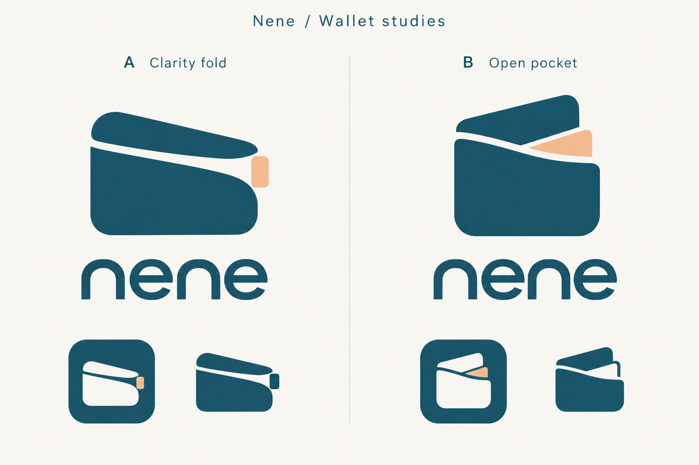
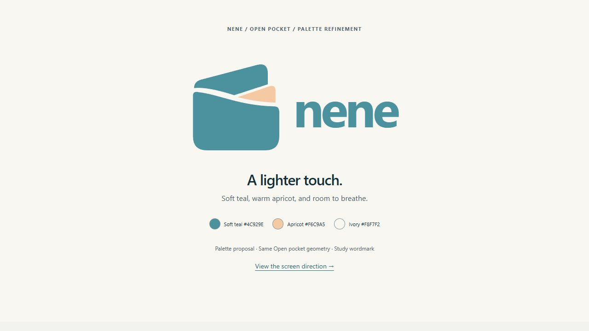

# Nene branding decision

Status: direction selected by the user on 2026-10-19. Production artwork and app integration are not implemented. This is a user design choice supporting UI/report presentation (TR-05/TR-06), not an extra assignment requirement. All seven banking feature groups remain in scope.

## Selected direction

Use **B — Open pocket** from the reference below for the working Nene identity. A — Clarity fold is an unselected comparison, not an alternative approved mark.

The upright wallet body, raised rear fold, curved opening, and visible apricot insert are the defining features. Preserve those relationships when preparing production artwork; do not replace them with a generic wallet glyph.

The intended meaning is **clarity and control over everyday money**:

- The wallet represents everyday money organized in one place.
- The open fold represents seeing and understanding what is available.
- The apricot insert draws attention to one useful detail or next choice.

These are design intentions, not claims about implemented banking capabilities, regulated status, or security guarantees. The insert is a visual metaphor; it does not add payment-card issuance or a separate wallet product to the PDF scope.

## Lighter palette refinement

After reviewing the first UI study on 2026-10-19, the user requested lighter surfaces and a lighter logo too. Preserve Open pocket's geometry. The current preview uses the softer values below; these exact shades are proposed for review. The original comparison board above remains historical shape/reference evidence, not the current color target.

| Color | Value | Intended use |
| --- | --- | --- |
| Soft teal | `#4C929E` | Main mark and study wordmark |
| Light apricot | `#F6C9A5` | Focus detail |
| Ivory | `#F8F7F2` | Light presentation background and reversed mark |
| Action teal | `#286E78` | Companion UI color for readable buttons, links and essential icons |

The original logo colors were deep teal `#164E63` and apricot `#F2BB91`; the lighter study supersedes those as the current proposal. The [three-screen UI study](UI_DIRECTION.md) records measured contrast for its revised pairs. Soft teal is reserved for the logo/large brand lettering; normal UI text and buttons use darker colors. Apricot remains decorative. Typography, screen theme and semantic colors are not yet approved for the app.

## Reference and visual check

The reference is a raster concept board produced with the built-in image-generation tool during the design discussion. The original output filename is `exec-38edb532-a91a-479a-97e8-7091f175e613.png`. This repository copy preserves the selected idea, not an installable logo or an editable vector master. No specific typeface or font license has been identified from the generated wordmark.

On 2026-10-19, a Google Lens search was narrowed to the main B symbol, excluding the wordmark and the other concept. The first two visible result groups were visually reviewed. A prominent result, [Knip by Altovera](https://play.google.com/store/apps/details?id=nl.altovera.knip), was checked on its official Google Play listing. It shares the wallet/card motif, but its rotated front card and fanned layers differ from Open pocket's upright body, sloping rear fold, curved opening, and apricot insert.

Design judgment: keep the selected direction; no near-duplicate was identified in the results reviewed. Wallet imagery is common, so this is a limited preliminary visual assessment, not proof of originality, name availability, or trademark clearance. No completed trademark registry search establishes availability for this concept or the Nene name.

## Remaining production work

- Rebuild one consistent editable vector master from the selected main B symbol. The concept board's small monochrome sample changes the insert treatment; resolve that discrepancy from the master instead of treating each generated sample as authoritative.
- Produce color, reversed, and single-color variants with the same silhouette. Establish clear space and a minimum size after checking 16, 24, and 48 pixel rendering and Android launcher masks.
- Choose licensed wordmark typography or deliberately drawn lettering; the preview does not identify a production font.
- Export transparent assets and Android launcher resources, then integrate with the existing app. Preserve future iOS compatibility without adding an iOS release to the assignment.
- Review the final geometry again for visual similarity before public release; the current check applies only to this draft. Name/trademark clearance remains unresolved.

The app still uses its existing foundation UI and launcher assets. On 2026-10-19 the user requested the PDF-based screen map and UI direction for sign-in, customer home and officer workspace; those proposals are in [SCREEN_MAP.md](SCREEN_MAP.md) and [UI_DIRECTION.md](UI_DIRECTION.md). The code-authored vector used there is a study, not a finalized production asset. Cloud provisioning, purchases and store publication remain outside this work. Keep implementation within [SCOPE.md](../SCOPE.md).
