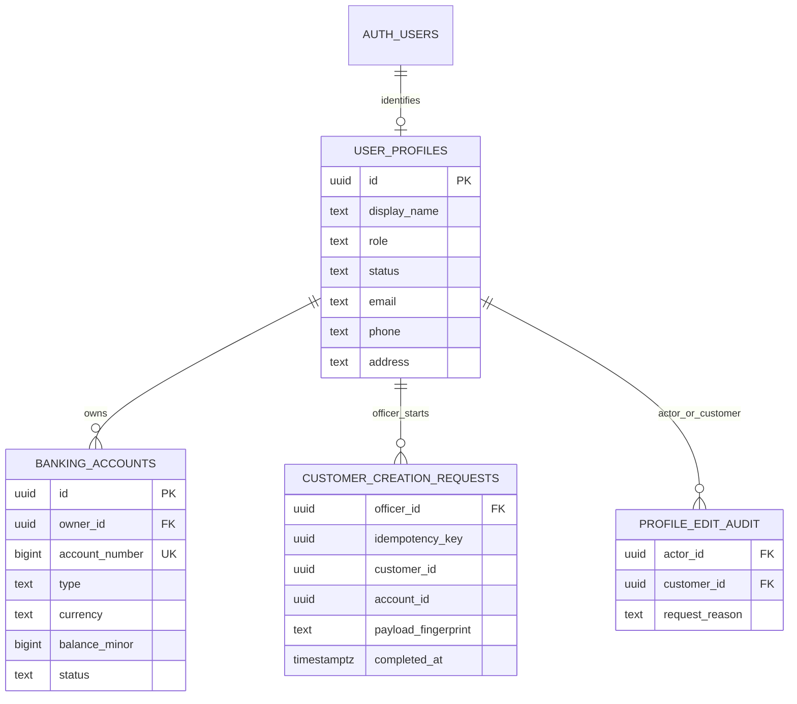

# First officer-to-customer flow

This implements part of BR-01/BR-02/BR-03/BR-05 and TR-03/TR-05/TR-06. The PDF requires officer account creation and requested edits, customer access to their own information, and three banking account types. It does not prescribe the initial account type, currency, opening balance or editable contact fields.

## First-demo decisions

These are provisional implementation defaults for the officer-to-customer flow authorized and discussed on 20 October 2026. They are project decisions, not assignment rules.

| Decision | First implementation | Later change |
| --- | --- | --- |
| Initial account | One checking account | Change new-customer defaults or add account-opening flows; saving and mortgage remain required. |
| Currency | VND, with integer minor units; VND has no fractional minor unit | New accounts may use an explicitly supported currency. Never relabel historical balances or transactions. |
| Opening balance | Zero | Funding is a separate financial operation requiring the chosen identity/2FA checks. |
| Customer edits | Own phone and address | Extend the backend's allowlist and validation deliberately. |
| Officer edits | Customer display name, phone and address, with a customer-request reason | Sign-in email changes need a coordinated Auth flow and are deferred. Role, balance and identity outcome remain protected. |
| Access setup | Officer enters a masked initial password for a synthetic customer | Local-only demo activation. Hosted activation, password reset and secure persistent sessions remain separate work. |

Creation rules belong in the backend. Mobile forms explain the current defaults but cannot assign a role, currency, balance, account owner or verification result.

## Journey and recovery

1. An existing officer signs in. Officer roles are bootstrapped through trusted local administration; the customer endpoint cannot create officers.
2. The officer enters synthetic customer details and an initial password, reviews the information, then creates the customer.
3. The backend reserves a request and customer identity, creates or reconciles that exact Supabase Auth identity, then commits the customer profile and initial checking account together.
4. The officer receives confirmation and gives the customer their sign-in details privately. The result does not return the password. No invitation email is sent.
5. The customer signs in, views their own profile and account, and updates their phone/address.
6. An officer can find the customer and make a permitted change upon request, recording a reason.

Identity remains unverified. No deposit, withdrawal, transfer, saving-rate change or payment is enabled by this slice. Authentication setup is not eKYC; creating a zero-balance account is not a deposit.

```mermaid
sequenceDiagram
    participant Officer as Officer app
    participant API as NestJS
    participant DB as PostgreSQL
    participant Auth as Supabase Auth
    Officer->>API: Create customer + Idempotency-Key
    API->>DB: Reserve request and identity UUID
    API->>DB: Lock reserved request
    API->>Auth: Find reserved UUID; create if absent
    API->>DB: Commit profile + account + completed request
    API-->>Officer: Customer and initial account
    Note over API,Auth: A retry uses the same UUID; Auth and PostgreSQL are not one distributed transaction.
```

An uncertain network outcome retains the creation request in the open form. Retrying sends the same key and payload. Reusing a key with changed details, including a different initial password, is a conflict. Auth creation may finish before a database/network failure; the durable reservation allows the backend to reconcile the same identity later. Never adopt another identity merely because its email already exists.

Correction is available after a validation `400` or a `409` carrying the allowlisted `CUSTOMER_EMAIL_EXISTS` code. The duplicate-email code is returned only after Auth reports the conflict and the backend confirms that the reserved identity is absent. These definitive rejections permit **Edit details** and a new request key. A generic `409`, timeout, unavailable service or invalid response retains the original draft/key for **Retry same request**; it does not permit an automatic replacement creation.

The database retains a salted scrypt-derived request fingerprint, not the plaintext password. This sensitive verifier is server-only. The password is held in form memory during the attempt and sent only to the backend/Auth; it is not returned or logged. Local debug traffic uses the emulator loopback development configuration. Hosted activation must be designed before enabling this creation flow against a hosted Auth service.

Ordinary app background/resume and token refresh for the same user revalidate the profile without replacing the workspace or pending draft/key. A transient profile-read failure retains that existing workspace; it does not bypass the backend's authorization of subsequent requests. Sign-out, confirmed expiry/access denial, or a changed identity/role clears protected state and invalidates outstanding results.

The current retry form is memory-only. Process termination, an app restart, or clearing the authenticated workspace loses its request key and password. Backgrounding preserves them only while the process and authorized session survive. A completed customer can be found through officer search; an unfinished reservation after a lost form needs trusted local investigation. This does not justify resetting the database or attaching an unrelated Auth user. Recovery after process death is not implemented.

## Data and permission boundaries



The request's reserved customer/account UUIDs exist before Auth/profile/account creation, so they are intentionally not foreign keys. The audit stores the actor, target, reason, submitted field names and time, avoiding copies of old/new personal values.

NestJS checks the active server-owned role on each request. Customer reads/edits are scoped to the authenticated subject. The database API role receives only the columns/operations this flow needs; it cannot update roles, status or financial balances. Mobile-facing Supabase roles remain blocked from the banking schema. Administrative Auth credentials stay on the backend.

## Acceptance evidence

See [API.md](API.md) for the contract and [SETUP.md](SETUP.md) for commands and actual verification results. The meaningful checks are:

- Officer-only customer creation, search and requested edits; no public signup or officer creation endpoint.
- Customer isolation, strict writable-field validation and persistent contact edits.
- Exactly one initial checking account with an explicit currency and zero balance.
- Duplicate email rejection, same-key/concurrent replay, changed-payload conflicts and failure recovery.
- Correction after definitive validation/duplicate-email rejection, with exact retries retained for uncertain outcomes.
- Same-user background/resume and token-refresh preservation; sign-out, expiry and role-change clearing.
- Retained server-owned roles, private storage and denied direct mobile table access.
- Accurate empty/error/loading states and a usable phone layout.

This slice is not completion of BR-03, BR-04 or BR-05. Saving/mortgage accounts, identity verification, transaction 2FA, hosted activation, integrations and all later [roadmap](../ROADMAP.md) items remain required.
