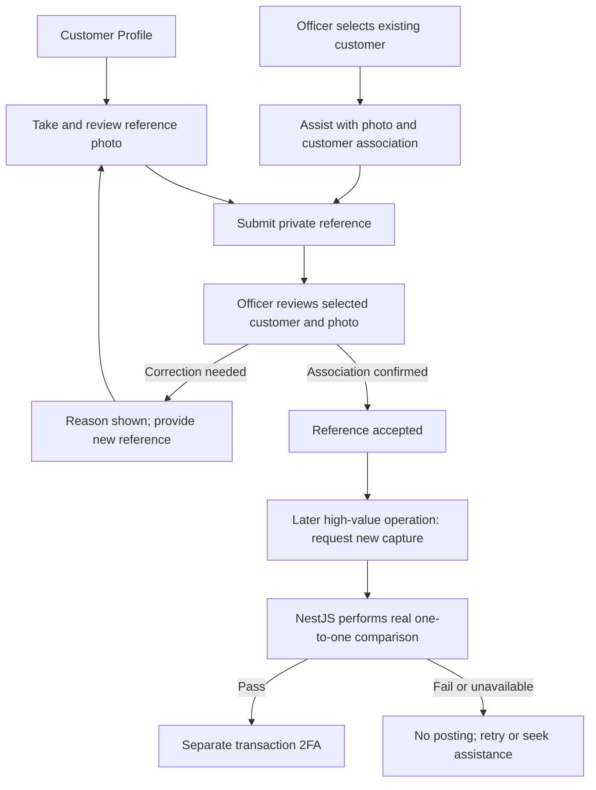
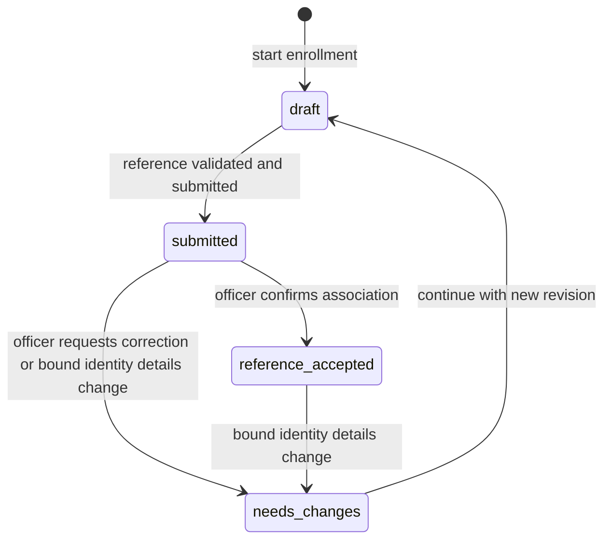

# Minimum identity verification flow

Status: **direction simplified and reference foundation implemented locally on 2026-10-27**. [REFERENCE_FLOW.md](REFERENCE_FLOW.md) records capture/status, private storage, officer acceptance/correction, retention defaults and verification limits. Actual face comparison and transaction 2FA remain pending. This document preserves the full design boundary beyond the implemented foundation.

The confirmed direction is **officer-assisted reference enrollment, an actual server-side one-to-one face comparison for high-value activity, and separate transaction 2FA**. AWS and all other matching providers remain undecided. A native AWS bridge, advanced liveness, document OCR/NFC and a commercial KYC suite are not prerequisites for the next task. [IDENTITY_OPTIONS.md](IDENTITY_OPTIONS.md) retains provider research as background, without a preferred vendor.

## Scope and completion boundary

| Source | Required outcome retained | Minimum design treatment |
| --- | --- | --- |
| BR-01/BR-02; PDF p. 1, Business 1 | Distinct permissions and officer assistance with customers. | Reuse customer Profile and officer Customer detail in the same Flutter app; no extra role or officer website. |
| BR-03; PDF p. 2, Business 2 | eKYC, biometric assistance and the face-photo example's high-value identity-check intent. | Establish an officer-associated reference, then demonstrate an actual comparison against it for a high-value operation. Reference storage/review alone does not complete BR-03. |
| BR-04/BR-09; PDF p. 2, Business 2/4 | All financial transactions pass 2FA and validity checks before posting. | Keep transaction-bound 2FA for every financial operation; a successful face comparison does not replace it. |
| TR-03/TR-05/TR-06; PDF p. 3, Technical 2/4 | Persistence and explainable data, flows and UI. | Persist private evidence references, decisions and relevant results; record implementation evidence as it is built. |

The [PDF](../FinalProject_2026_2027.pdf) and [requirement register](../REQUIREMENTS.md) remain authoritative. Face capture is the source's example; this face-based minimum is our chosen design direction, not a PDF-prescribed vendor or algorithm. Exact matching implementation, high-value threshold, second-factor method and lecturer expectations for eKYC depth remain open. All seven business feature groups remain in [ROADMAP.md](../ROADMAP.md).

There are three different milestones:

- **Reference accepted:** an officer has associated the submitted reference photo with the selected, already-provisioned customer under the documented confirmation procedure. This is a human enrollment decision, not an automated match, proof of live presence or government-document verification.
- **Identity check passed for this operation:** NestJS has obtained an actual matching result for the accepted reference and a newly requested capture, bound to one exact operation. It grants no reusable payment permission.
- **Transaction 2FA passed:** the separate second factor is valid for that same operation, allowing final backend checks and posting.

Do not use a global **Identity verified** badge for enrollment. Simulated comparison results remain labeled **Demo check only** and cannot satisfy the required operation check or complete BR-03. No financial actions are available in the current app.

## Minimum customer and officer journey

Officers confirm which already-provisioned demonstration customer the reference belongs to. Proposed minimum procedure: use the selected customer record, assist the customer with capture, compare the reference with the person being assisted, and record that confirmation. A customer may submit a photo first, but a name/photo pair alone is not enough for acceptance; the officer must establish that association. The exact confirmation procedure and any stronger lecturer expectation must be settled before claiming completed eKYC. No default collection of ID numbers, document scans, birth dates or extra personal fields is added.

### Customer screens: C16

| Step | Essential content and actions | Backend/result rule |
| --- | --- | --- |
| Status and instructions | **Identity reference**; Not started / Draft / Awaiting review / Changes requested / Reference accepted; purpose/access/retention notice; **Start** or **Continue**; officer-assistance guidance. | Read the customer's own case. A failed read is unavailable, never Not started or accepted. No provider must be configured merely to start enrollment. |
| Capture and preview | **Take photo**, preview, **Retake**, **Continue**; camera permission guidance. | One reference photo for this version. Validate actual file contents before accepting the upload. Denied/unavailable camera offers officer assistance; it never grants a pass. |
| Review and submit | Selected profile name/reference, photo preview and notice acknowledgement; **Submit reference**. | Submit only acknowledged private evidence. Name corrections use the existing officer-requested edit path. No self-approval. |
| Result and correction | **Reference submitted - awaiting officer review**, correction reason, or **Reference accepted for later identity checks**; **Check status** / **Back to profile**. | Success means the stated reference action persisted. Accepted reference is not completion of all eKYC or authorization for any transaction. |

### Officer screens: O06

| Step | Essential content and actions | Backend/result rule |
| --- | --- | --- |
| Customer identity overview | Existing customer context and reference status; **Assist with reference** or **Review reference**. | Active officer plus selected active customer. Start from O03; no new queue, ticket system or separate application is required. |
| Assisted capture | Same notice, capture/retake and submission steps; customer's request/acknowledgement recorded with officer attribution. | Same file rules as customer collection. Do not falsely attribute an officer-recorded acknowledgement to a customer login. |
| Review and confirm | Customer identity, submitted photo/version and association confirmation; **Accept reference** or **Request correction**; correction reason; confirmation summary. | Accept only when the officer has established the reference/customer association. No automatic face score is fabricated. Review uses the exact submitted version. |
| Result | **Reference accepted**, **Correction requested**, or **Outcome not confirmed**; return to the customer or check status. | Show the committed decision. A stale decision must be re-reviewed; a missing reply is not a failed or accepted decision. |

The assisting officer may review the reference; the PDF does not require a second officer or multiple approval levels. If identity cannot be established, request correction/assistance with a useful reason. That decision does not disable the customer's login or banking account. Officer self-enrollment and interpretation of “customers and users” remain a lecturer question; these customer routes do not approve officers.

## Simple state and data rules

No case means **Not started**. Keep one current case per customer with a version, reference revisions and review history. Durable states are:

Loading, upload progress, network errors and opening a review screen are not durable identity outcomes. No electronic matcher or liveness result is required to record an enrollment reference. Actual comparison results belong to the later high-value operation, with their own pass/fail/unavailable/expired status.

Retain the safeguards needed for this small flow:

- NestJS verifies the Supabase session, active role and ownership. Customers access only their own case/files; officers act on a selected active customer. Bank tables and private Storage remain inaccessible through client-facing data APIs. Neither role can post an arbitrary comparison result.
- Route reference uploads and reads through NestJS. Keep the configured private bucket's JPEG/PNG and 10 MiB ceiling; decode/validate actual contents and bound dimensions/resources before accepting. Proposed decode ceiling remains 4096 x 4096 pixels. Server-generated object keys, no public image URLs, no arbitrary remote URL fetching. These are project limits, not PDF rules.
- Freeze each submitted photo/profile revision. Retakes create a new revision instead of replacing evidence under an existing review. Store customer/case IDs, private references, state/version, notice acknowledgement attribution, reviewer/decision/reason and server timestamps. Avoid copying images, credentials or unnecessary personal data into logs.
- Accept-reference/request-correction commands check the expected version and record their decision/audit atomically. Two officers cannot silently overwrite one another. Corrections need a customer-facing reason; the existing 5-500 character reason convention is a proposal for reuse.
- Retry keys identify the actor, command, case and unchanged payload. An exact retry returns the recorded result after authorization; changed payload or stale version conflicts. Unknown outcomes are checked through case status before another overlapping action.
- Storage and PostgreSQL are not one transaction. Reserve the file identity before writing; incomplete uploads stay unready and cannot be submitted. Reconcile retries and clean abandoned files according to a defined retention policy. Never delete referenced evidence as an orphan.
- A requested officer name change invalidates an accepted reference and outstanding checks based on the old identity revision, atomically with that edit. Move a submitted/accepted case to correction, or advance a draft version. Keep history. Initial phone/address edits alone do not change this name-bound rule; extend the bound fields only if the chosen method needs them.

Do not change application profile/account status or create/fund an account during reference review. The reference state is separate. The additive reference migration grants only case/evidence/command/review access; it adds no role, status or financial privileges. Later comparison records remain future work.

### Reference API contract

These routes are implemented under `/api/v1`; [API.md](API.md) records exact inputs, summaries and failure handling. The later high-value comparison API is not implemented.

| Route family | Purpose |
| --- | --- |
| `GET /me/identity`; `GET /officer/customers/:customerId/identity` | Own/selected-customer reference status, current case/version and allowed actions. |
| `POST /me/identity/cases`; `POST /officer/customers/:customerId/identity/cases` | Start/reuse the one current case; resume a needs-changes case into a new draft revision. Record the notice acknowledgement and officer assistance context as applicable. Accepted references are read-only until invalidated. |
| `GET /identity/cases/:caseId` | Authorized current state, version, private evidence IDs and safe review result/reason; also used to reconcile missing replies. |
| `POST /identity/cases/:caseId/evidence`; `GET /identity/cases/:caseId/evidence/:evidenceId` | Bounded draft upload and authorized preview stream. Verify case/file association; no user-supplied bucket or object key. |
| `POST /identity/cases/:caseId/submit` | Expected version, acknowledged notice and ready reference; freeze the revision and mark submitted. No provider call or synthetic electronic pass. |
| `POST /officer/identity/cases/:caseId/reviews` | Officer-only `accept_reference` or `request_changes`, expected version and confirmation/reason. Reject client `isVerified`, role and match-result fields. |

Keep one NestJS identity service/repository and a Flutter repository/controller. No provider plugin in screen widgets, extra backend or generic workflow engine. Use the existing no-store response policy, safe authentication/permission errors, indistinguishable unavailable/unauthorized resource IDs, and explicit validation, conflict and dependency errors.

Unsent captures/drafts remain memory-only and clear on sign-out, confirmed role/identity change or process termination. Ordinary same-user refresh may preserve them after revalidation. After fresh login, recover acknowledged server state via the own/selected-customer summary. Back/closing a screen does not cancel a submitted reference. On an uncertain reply, show **Outcome not confirmed - check status** rather than resubmitting blindly. Stop camera use when leaving capture/backgrounding. Define cleanup and evidence retention before collecting images.

## Later high-value check and transaction 2FA

1. The customer reviews the financial operation in S02. NestJS evaluates the server-owned high-value rule; the amount threshold is still undecided.
2. For a high-value operation, S03 requests a new camera capture and shows which operation is being checked. The server obtains the customer's accepted reference, performs **actual one-to-one face comparison**, and evaluates the documented matching/quality policy. Choose and test the smallest suitable comparison implementation at this stage; AWS has no priority and no provider-specific bridge is scheduled.
3. Bind the result to customer, accepted reference/profile revision, exact operation details and expiry. Editing the operation invalidates authorization. Missing, failed, unavailable, expired or mismatched results cannot post; an officer cannot override them with reference acceptance.
4. Every financial operation still passes S04 transaction-bound 2FA, including those below the high-value threshold. Its method/channel remains a separate decision. NestJS rechecks ownership, financial rules, applicable identity result and factor, then atomically posts/consumes authorization once.

Proposed bank policy: require an accepted reference before enabling financial posting, while allowing ordinary sign-in, reads and permitted contact edits. This is our design choice, not a direct PDF rule. A stored reference alone never enables a money feature that lacks its other checks. Pre-authorization intent/check metadata remains distinct from posted transactions; the brief's persistence wording retains its existing lecturer-interpretation question.

**Security limit:** camera capture requests new evidence but does not prove live presence or prevent image injection. A face matcher may match a photograph or replay. An operation token prevents reuse of a result for another operation; it does not establish when the image was captured. Document this limitation and clarify whether it meets the course's expected eKYC depth before claiming complete acceptance. Advanced liveness, document checks or another stronger mechanism can be selected later for a concrete requirement; they are not silently added to this minimum or claimed to exist.

## Visual direction and verification

Preserve [UI_DIRECTION.md](UI_DIRECTION.md), [BRANDING.md](BRANDING.md) and the existing [Nene theme/logo](../app/lib/ui/nene_brand.dart): ivory pages, white evidence/form surfaces, dark readable text, action-teal buttons and the lighter teal/apricot mark. Keep customer context, status, photo and next action in that order. Use one scrollable column, persistent labels, at least 48-logical-pixel targets and wrapped text/reasons at 200% scaling. Avoid a green global verified badge or fabricated face scores. Rendering, camera, keyboard and screen-reader behavior still need implementation checks.

| Future acceptance evidence | Requirement |
| --- | --- |
| Customer and officer-assisted reference submission, private persistence and permitted role actions; status survives fresh login. | BR-01/BR-03/TR-03 |
| Officer acceptance/correction records the correct customer and reference version; neither action creates an automated match or changes account status. | BR-01/BR-03 |
| Other customers' cases/files, client data APIs, forged roles/results and public image access are rejected. | BR-01/BR-03/TR-03 |
| Invalid files, permission denial, interrupted upload, lost replies and competing reviews recover without false acceptance or silent overwrite. | BR-03/TR-06 |
| Real matching and non-matching captures produce backend decisions against the accepted reference; an unavailable matcher never defaults to pass. | BR-03 |
| Expired/reused/wrong-operation results and outdated reference/name revisions cannot authorize high-value posting; ordinary and high-value operations still require 2FA. | BR-03/BR-04/BR-09 |
| Record the absence of liveness and observed spoofing/replay weaknesses honestly; do not treat fixtures or stored photos as full BR-03 evidence. | BR-03/TR-06 |
| Android capture/permission behavior and small-screen/large-text/keyboard/screen-reader paths are exercised. | TR-02/TR-06 |

The table spans implemented reference behavior and future comparison/2FA acceptance targets. [REFERENCE_FLOW.md](REFERENCE_FLOW.md) records performed checks and their limits. BR-03 remains open until meaningful electronic checks and the agreed eKYC interpretation are demonstrated.

## Next tasks and open decisions

**Next: exercise the reference flow in the Edge web demo, then select and prove the later comparison implementation.** The implemented reference foundation uses notice `reference-demo-v1`, explicit acknowledgement/association confirmation, seven-day access expiry and maintenance-driven deletion; see [REFERENCE_FLOW.md](REFERENCE_FLOW.md). Real-person captures still need an explicitly agreed test-data procedure. A synthetic account name does not make a real face synthetic.

Then select and prove a real comparison implementation, define its quality/threshold/attempt/expiry policy and the high-value amount rule, and connect it to operation-bound checks. Select and implement transaction 2FA before any financial posting. Lecturer expectations for the enrollment procedure, officer-subject coverage and any simulated integration remain unresolved; no waiver is assumed. The remaining account, payment, utility, map, chat and submission work stays in the roadmap.

## Review record and retained design provenance

This revision records the user's 2026-10-27 simplification. It removes mandatory electronic/liveness checks from reference enrollment, uses truthful reference-status labels, and defers the comparison implementation without dropping high-value verification or transaction 2FA. AWS remains undecided. The prior map's verification/provenance record below describes its original document-level review; it is not evidence that the revised application behavior exists.

2026-10-27: extracted and visually reviewed all three PDF pages; reconciled this map with the requirement register, scope audit, current API/guard, private-bucket migration and Flutter brand component. Walked the proposed successful, correction, declined, unavailable-method, stale-review, late-result and lost-response paths at document level. Source/link/diff checks accompany this change. No app behavior, runtime test, rendered identity UI, camera integration, provider result or accessibility result is claimed. The shared policy directory `D:\Data\Downloads\Policies` was unavailable; no compliance with its unknown contents is claimed.

Visual origin is Nene's existing approved design. Planning used selected local Interface Atlas guidance (directory `db910e7c6328`): UI/UX draft dated 2026-10-20 and state/recovery, forms/navigation and uncertain-outcomes research drafts, revision 0.2 dated 2026-10-15. Atlas synthesis is credited to Tamir (Phi Vuong Tuong Tam), with Codex AI assistance. The selected methods are task transitions, authoritative-state ownership, review/correction and uncertain-response recovery; no external theme, runtime, asset or substantial guide prose was copied. Snapshot hashes below identify the consulted local files; an upstream committed revision was not established.

| Local guide | SHA-256 |
| --- | --- |
| `ui-ux-design.md` | `7bfa8b14b2529d599a9a932f1e61832e6d638556bc7684635621ef3ea81112c5` |
| `state-and-recovery.md` | `ddd338c88cb26e5001c6209e91d4d3b53089912ac2bee68a9c3a95ba5eda7c51` |
| `forms-and-navigation.md` | `870844c51547c2083a5b33d97048c7fdae1bdd7850a214ae375bdc3940e93b5b` |
| `uncertain-outcomes.md` | `7977ea92734b0457dee69f041b22f88061970c83070fb85976a56e119736cb10` |

Selected source credits carried by that guidance: Ghaida Zahran's [Journey/Evaluate](https://github.com/ghaida/intent/tree/3fc38dff381ce0e4dec8f52c97c3e37abd95e10e/skills) (CC0, task/re-entry framing); Jakub Krehel's [better-* guidance](https://github.com/jakubkrehel/skills/tree/4c66b1fa86e9ab70187b43d7da9b6fdb29f2ef63/skills) and Julien Thibeaut's [improve-ui](https://github.com/ibelick/ui-skills/blob/f18d13077d6e3841821ea0a36526c0fd44a570b5/skills/improve-ui/SKILL.md) (MIT, hierarchy and respecting existing design); W3C WAI's [forms guidance](https://www.w3.org/WAI/tutorials/forms/) and GOV.UK's [check-answers pattern](https://design-system.service.gov.uk/patterns/check-answers/) (reference guidance, not copied implementations); and [RFC 9110](https://www.rfc-editor.org/rfc/rfc9110.html), edited by Roy T. Fielding, Mark Nottingham and Julian Reschke (protocol reference, not proof of Nene behavior). Project rules above are original proposals; source terms do not imply endorsement, accessibility certification or a tested service contract.
