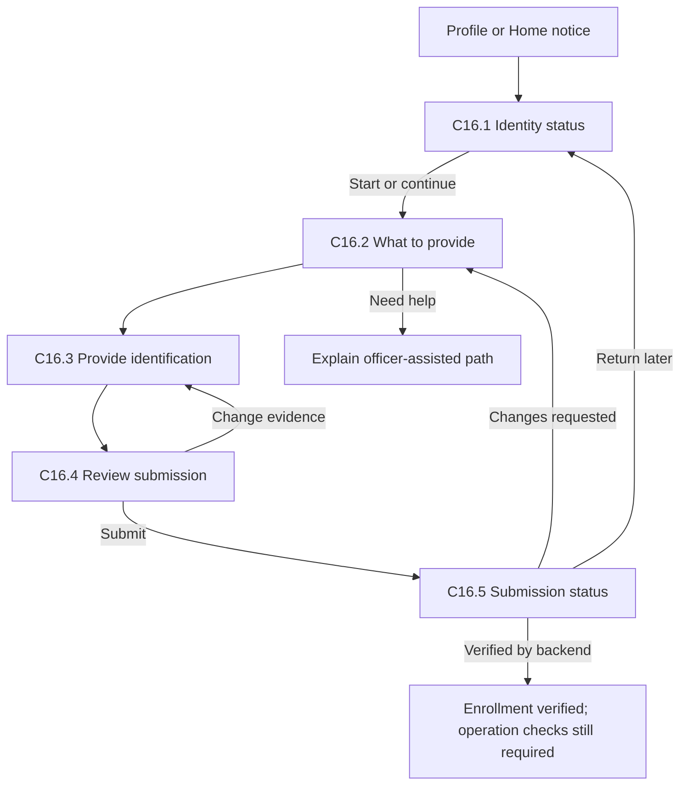
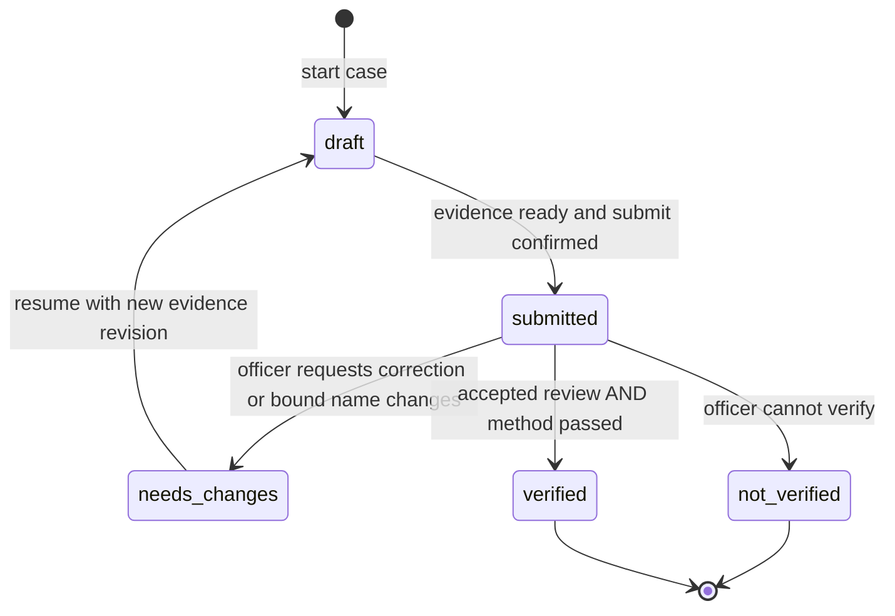
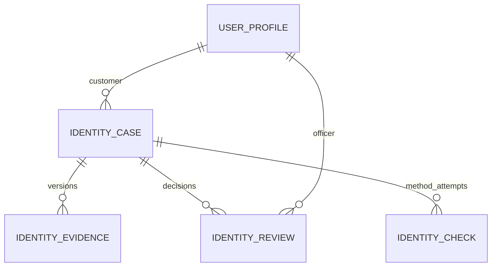
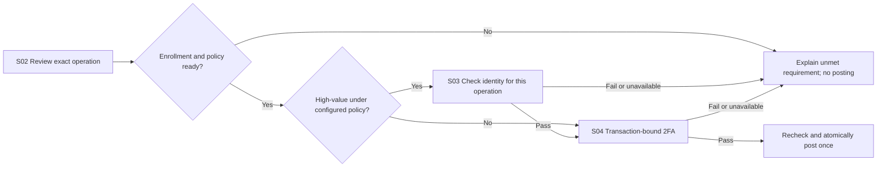

# Identity verification: screens and backend rules

Status: design proposal mapped on 2026-10-27 at the user's request. **No identity screens, upload routes, review decisions, eKYC checks or transaction 2FA are implemented by this document.** The current app still provides the [first customer/account flow](CUSTOMER_FLOW.md); the private evidence bucket exists without an application upload flow. Method/provider selection remains open.

This is the detailed handoff for C16 and O06 in [SCREEN_MAP.md](SCREEN_MAP.md), with the boundary to S03/S04. It uses the confirmed Flutter + NestJS + Supabase architecture and approved [lighter Open pocket identity](BRANDING.md). Screen divisions, statuses, API names and validation policies below are engineering proposals, not additional PDF requirements or lecturer-approved exceptions.

[Identity options research](IDENTITY_OPTIONS.md), dated 2026-10-27, recommends AWS Face Liveness + CompareFaces with officer-assisted enrollment, conditional on Android integration and explicit method approval; FPT.AI is the simpler API alternative. The user accepts a small usage budget for comparison, not account creation or expenditure. No provider is confirmed. If AWS is selected, revise the generic upload route for its native capture stream and specify the identity baseline, result handling and capture credentials before implementation.

## 1. Source boundary

The original [assignment PDF](../FinalProject_2026_2027.pdf) was reread in full, including rendered pages. Requirement IDs follow [REQUIREMENTS.md](../REQUIREMENTS.md), with interpretations in [SCOPE.md](../SCOPE.md).

| Source | Outcome retained | Boundary for this design |
| --- | --- | --- |
| BR-01/BR-02; p. 1, Business 1 | Distinct customer/officer permissions; officers assist customers and make requested changes. | Reuse the same app, authenticated profiles and customer detail. No public signup, new administrator role or separate review website. |
| BR-03; p. 2, Business 2 | Login, electronic identification, officer-assisted biometric identification and high-value verification intent. | Preserve both customer and assisted paths. Face capture/upload is the source's example, not a selected algorithm, liveness vendor or compulsory identity-document checklist. |
| BR-04; p. 2, Business 2; BR-09, Business 4 | Every financial transaction requires 2FA and must be allowed/valid before persistence. | Enrollment approval does not authorize a payment. S03 and S04 remain separate from enrollment and from each other. No low-value 2FA exemption. |
| TR-03/TR-05/TR-06; p. 3, Technical 2/4 | Persistence and explainable data, component, use-case and UI design. | Store evidence privately with database references; record the rules and future acceptance evidence. These diagrams are design evidence, not completed implementation evidence. |

The PDF does not set a high-value threshold, OTP channel, image-retention period, face algorithm, identity-document fields or criteria for accepting simulated verification. It also leaves the identification of officers themselves ambiguous. Those questions remain visible in section 9. This slice does not remove any of the seven business feature groups.

## 2. Three distinct security outcomes

| Outcome | Who establishes it | What it permits |
| --- | --- | --- |
| Enrollment verified | NestJS derives it from the selected method's successful result, the exact submitted evidence revision and the required officer review. Mandatory review is this slice's proposal. | Satisfies the proposed enrollment prerequisite for later financial actions. It does not itself authorize any operation. |
| High-value identity check passed | Selected method, evaluated by NestJS against a particular operation and enrollment revision. | Allows that operation to proceed to transaction 2FA; cannot be reused for another operation. |
| Transaction 2FA passed | NestJS validates the chosen second factor bound to the user and exact operation. | Allows final business checks and posting, once all other conditions pass. |

**Accepting evidence is not the same as verifying identity.** Officer review may accept the submitted material while the electronic check is pending, unavailable or unsuccessful. A photo, a client-supplied `passed` flag, an officer button, Supabase login or device unlock cannot stand in for the selected verification method. Simulated outcomes must display **Demo check only**, remain distinct in stored metadata and never grant genuine verified eligibility.

Proposed initial gate: allow sign-in, account/profile reads and permitted contact edits while enrollment is incomplete; block financial posting until enrollment and the operation's required checks pass. That gate is a project policy, not a quoted PDF rule. All financial posting is already unavailable in the current implementation.

## 3. Customer journey: C16

Entry: Profile -> **Identity verification**. A missing-enrollment notice on Home may link to the same destination. No extra bottom-navigation destination.

The numbered views are steps/states of C16, not a requirement for five independent routes.

| View | Content order and actions | Backend acknowledgement / next step |
| --- | --- | --- |
| C16.1 Identity status | Title; text status; last submitted/reviewed time when known; useful reason/next step. **Start verification**, **Continue**, **Provide new evidence**, or **Check status**, according to allowed actions. | Read the customer's current case. Distinguish no case from unavailable service. Never default a failed read to Not started or Verified. |
| C16.2 What to provide | Explain the selected method, required evidence, purpose, authorized access and actual retention policy; acknowledgement; **Continue**; **Get help from an officer**. | Backend supplies the enabled policy/method version. Required evidence and notice acknowledgement must match it. Until the method and retention policy are chosen, this is a design placeholder, not a working collection screen. Help explains the existing officer-assisted route; it creates no ticket, booking or message. |
| C16.3 Provide identification | Method-specific guidance; evidence area; **Take photo** / **Retake** for a selected photo method; preview and upload state; **Continue** when required evidence is acknowledged. | Request camera permission only at capture. File upload, if offered by the chosen enrollment method, is not evidence of live presence. Denial/unavailable hardware offers permission guidance and officer assistance; never marks the step passed. |
| C16.4 Review submission | Read-only customer name/reference, method, current evidence preview, acknowledgement and correction links; **Submit for verification**. | Submit one immutable evidence revision. Officer-controlled name corrections return through the existing requested-edit flow. Do not collect date of birth, address documents, government ID numbers or front/back scans without a method-specific need and scope decision. |
| C16.5 Submission status | **Submitted - awaiting review**, **Evidence reviewed - verification pending**, **Changes requested**, **Not verified**, or **Identity verified**; submitted reference/time; correction reason; **Check status** / **Back to profile**. | Render the authoritative result only. Submission success means received, not verified. No promised completion time or unsolicited notification subsystem. A failed status refresh leaves the last known state visibly stale. |

Photo previews use synthetic fixtures during development. Do not ask the user for real identity images to complete this design task. No face-match score, success animation or “bank-grade” claim is shown without actual supporting behavior.

## 4. Officer journey: O06

Entry: existing Workspace -> Customers -> Customer detail -> **Identity verification**. A small **Awaiting identity review** list on Workspace can link to the same customer/case; it is an optional shortcut within O06, not a new approval product.

| View | Content order and actions | Backend rule |
| --- | --- | --- |
| O06.1 Customer identity overview | Fixed customer name and distinguishing email/reference; current enrollment status; submission time; **Review submission** or **Assist with identification**. | Active officer and active customer required. Search stays in existing O02. A queue, if implemented, returns only case summary data and no identity images. |
| O06.2 Assisted collection | Fixed customer context; selected method/instructions; customer's acknowledgement recorded with officer attribution; reason for assistance; capture/preview; review then **Submit for verification**. | Same evidence validation and submission rules as C16. Officer records acting on the customer's request; acknowledgement is explicitly officer-recorded, not falsely attributed to the customer's session. Assistance creates no automatic approval or electronic pass. |
| O06.3 Review submission | Customer context; revision/time; privately loaded evidence; electronic-check status and method; prior correction reason if relevant; **Accept evidence**, **Request new evidence**, **Cannot verify**. | Actions operate on the reviewed case version. Accept records a human review only. Request-new-evidence and Cannot-verify require a safe customer-facing reason. An unreadable evidence file or unavailable check cannot be treated as a pass. |
| O06.4 Confirm review | Customer/reference; evidence revision; chosen action and reason; explanation of result; **Confirm review** / **Back to review**. | Backend rechecks role, state and version, then commits decision and audit together. Accept says “Accept this evidence. Identity is verified only when the configured identity check also passes.” |
| O06.5 Review result | **Evidence accepted - verification pending**, **Identity verified**, **Changes requested**, **Not verified**, or **Outcome not confirmed**; return to case/customer. | Show the committed result, not the clicked label. A conflict asks the officer to reload/review the current case. A lost reply offers **Check status**, not another blind decision. |

The officer who assisted may review evidence in this minimal proposal; the PDF does not require a second officer or multiple approval levels. The actual identity method still must pass. Officers cannot use these routes to enroll/approve their own officer identity, promote roles, disable customers, edit balances or bypass transaction checks. **Cannot verify** closes this submission without disabling the login or banking account; a later attempt is a new officer-initiated case with a reason and a link to the previous case. Recoverable image problems use **Request new evidence** instead.

## 5. Layout and interaction handoff

Use [UI_DIRECTION.md](UI_DIRECTION.md) and the existing `NeneLogo`, `NeneColors`, `neneTheme` in [nene_brand.dart](../app/lib/ui/nene_brand.dart). This is a project-owned visual direction; no new theme, font package or branding asset is selected.

| Layer | Customer screen | Officer screen |
| --- | --- | --- |
| Header | Back; small Open pocket mark; **Identity verification**. | Back; mark; **Review identity**. Customer context remains visible below the title. |
| First content | Text status and next useful action. | Customer/reference, submitted time and evidence revision. |
| Main content | Instructions -> evidence preview -> review or result. | Evidence preview -> actual check status -> decision and reason. |
| Footer actions | One primary action per step; secondary retake/back/help links. | Review actions have distinct labels; final confirmation repeats the selected action. No ambiguous generic “Approve” button. |

Use ivory `#F8F7F2` pages, white evidence/form surfaces, pale teal `#EFF7F5` status panels, ink `#172F38`, muted text `#4D626B`, and action teal `#286E78` with white button text. Soft teal `#4C929E` and apricot `#F6C9A5` remain logo/decorative colors. Error text uses the existing `#9B3434`; every status also has words, never color alone.

Proposed layout: 20 logical-pixel page padding, 24 between sections, 12 between related fields, 24 title, 16 body/input and 14 supporting text. Reuse 12-radius input/buttons, 18-radius evidence surfaces and 54-minimum-height primary buttons. These are layout choices, not observed usability results. Keep content in one scrollable column; a wide preview centers it at a maximum width of 560. Evidence keeps its aspect ratio and has an accessible **View evidence** action; do not crop away identification information to fill a decorative shape.

Place actions after content in the scroll flow with safe-area/keyboard spacing. At 200% text, labels/reasons must wrap without clipping or hiding the primary action. Touch targets are at least 48 logical pixels. Give controls persistent labels; move focus to the new step heading or first invalid field after deliberate navigation/submission, and restore focus after preview closure. Background status updates announce without stealing focus. Capture requires a working alternative explanation/assistance path when permission is denied. Keyboard, screen-reader, large-text and Android camera behavior still require implementation testing.

## 6. Backend state and access rules

NestJS owns the case and result; Flutter owns only navigation and the unsent draft. Keep identity state separate from `user_profiles.status` (active/disabled) and account status. Do not add a client-writable `isVerified` field.

### Enrollment state machine

No case is the UI's **Not started** state. Network loading/error, upload progress and “review open on an officer's screen” are not durable enrollment states. `submitted` remains pending if review is accepted but the method has not passed. Store electronic results separately as `pending`, `passed`, `not_passed` or `unavailable`, bound to an evidence revision and method/policy version. Failed/unavailable checks never become `passed` through review alone. A failed match offers a documented correction/assistance path, not repeated unbounded attempts or a manual override.

| Command | Preconditions | Committed effect / protection |
| --- | --- | --- |
| Start/continue case | Customer acts on self, or officer on selected active customer; method configured. | One current case per customer; serialize creation/replacement by customer. Repeated start returns that case. No client-selected owner on customer routes. |
| Upload/replace evidence | Current case in `draft`; authorized actor; expected case version. | Validate file, persist private reference and acknowledge ready evidence. Replacements create new references; old submitted snapshots remain immutable. |
| Submit | `draft`; all configured evidence ready; current notice acknowledged; expected version. | Freeze evidence/profile/method revision, set `submitted`, record actor/time and a stable method-check ID. Invoke the selected check through the backend; an unavailable check remains pending/unavailable, not passed. No account changes. |
| Accept evidence | Active officer; `submitted`; reviewed evidence available; expected version. | Record accepted review; derive `verified` only when the trusted method result for that same revision is `passed`. Otherwise remain submitted with truthful pending/failure guidance. |
| Request new evidence | Active officer; `submitted`; expected version; reason. | `needs_changes`; preserve old submission and decision. Customer or officer resumes a new draft revision; invalidate prior check results for that draft. |
| Cannot verify | Active officer; `submitted`; expected version; reason. | `not_verified`; retain result/reason and require officer assistance for a new case. Never disable login automatically. |
| Record method result | Backend integration only; known check ID, current submitted revision and policy. | Validate/authenticate the result and deduplicate it. Recompute status atomically; a late result for replaced/closed evidence cannot verify the current customer. |

All commands recheck active server-owned roles and customer ownership. Customers cannot enumerate cases or evidence belonging to others; unknown and unauthorized case IDs return the same 404. Officer routes return 403 for a customer caller. Evidence access also checks that the file belongs to the authorized case, not just that a UUID is valid.

Use an integer `version` checked inside the same database transaction as each mutation and its audit event. Two officers may read one case; only the decision matching the current version applies. A stale request returns `409 CASE_VERSION_CONFLICT`; refresh and require a new review, never silently overwrite. Trusted asynchronous method-result updates participate in the same concurrency boundary.

Proposed profile binding: submission records the server-controlled name revision. A later officer name change invalidates enrollment eligibility and outstanding checks based on the old name, atomically with that name edit. Preserve historical results but derive current eligibility as needing verification. C16/O06 show **Verify your updated details**, never a current Verified badge based on the old case. For an invalidated terminal verified case, the customer or officer can explicitly start a replacement linked to the old case; serialize this with the name edit and case creation. A submitted case moves to `needs_changes`; an existing draft stays a draft with a new version. Either path requires review of the updated name and a fresh submission revision. Phone/address edits alone do not invalidate this initial name-bound policy. If the selected method uses other fields, expand the bound fields explicitly before implementation. This is a necessary future change to the existing edit path, not behavior already present.

### Private evidence and minimal data

- Reuse private `identity-evidence` Storage. Bank tables remain outside client-facing data APIs; client roles retain no Storage access. Initial proposal: NestJS streams authorized uploads/downloads rather than returning public or long-lived signed URLs. No mobile administrative credential or user-supplied bucket/path.
- Keep the existing JPEG/PNG, 10 MiB per-file ceiling. Proposed additional decode limit: 4096 x 4096 pixels; validate actual bytes/dimensions, strip unnecessary metadata and re-encode before marking ready. Do not trust MIME/extension alone. No SVG, remote URL fetching, arbitrary file browser or document repository is introduced. Revisit limits only if the chosen method requires it.
- Reserve a random evidence ID/key and request record before the Storage write. Storage and PostgreSQL are not one transaction: interrupted writes remain unready, are reconciled by the same key and server-computed content hash, and cannot be submitted. Define a cleanup period for abandoned files before implementation; cleanup cannot remove referenced submitted evidence.
- Store case owner, initiating actor, case/version/state, evidence revision/references, notice version/acknowledgement attribution, method/policy/check reference and minimal result, review actor/action/reason/time. Record access/decision audit metadata without copies of photographs, tokens, biometrics or raw provider responses in logs.
- Customer-facing reasons are required for corrections/declines, 5-500 characters as a proposed reuse of existing reason validation. Explain the next action without sensitive internal diagnostics. Do not add a general internal-notes product.
- Case, evidence and review records need explicit foreign keys, version/uniqueness constraints and narrow `nene_api` privileges in a future migration. Keep role/status/balance grants unchanged. Raw files live in private Storage; their ownership, lifecycle and result live in PostgreSQL.

Proposed relationships, not a migration or a completed report ER diagram:

`IdentityCheck` distinguishes enrollment from later operation-bound checks. Exact tables can be combined where useful, but evidence revision, human decision and electronic result must remain distinguishable. No bank account is created or funded by identity submission.

### Proposed API surface

All routes below are **future** `/api/v1` routes, separate from the implemented contract in [API.md](API.md). Add a small identity module/service/repository to the existing NestJS application; no new backend or Edge Function service. Flutter uses an identity repository and ChangeNotifier controller, not Storage/provider SDK calls in widgets.

| Route | Actor / contract | Screen |
| --- | --- | --- |
| `GET /me/identity` | Customer's status, current case/version, derived current enrollment eligibility, method availability, notice and required evidence, allowed actions. | C16.1-C16.2 |
| `POST /me/identity/cases` | Start/reuse own current case; explicit replacement of an invalidated verified case binds the previous case/version. After `not_verified`, return assistance guidance instead of creating another case. | C16.2 |
| `GET /officer/customers/:customerId/identity` | Officer reads selected customer's identity summary/current case. | O06.1 |
| `POST /officer/customers/:customerId/identity/cases` | Officer starts/reuses case with assistance/request reason; replacement of a terminal case requires explicit previous case/version and reason. Current valid verified enrollment is not replaceable through this initial flow. | O06.2 |
| `GET /identity/cases/:caseId` | Owner or authorized officer; authoritative state, version, evidence references, safe result/reason and allowed actions. | Status, review and uncertain-outcome recovery |
| `POST /identity/cases/:caseId/resume` | Owner/officer; `needs_changes` -> `draft`, advance revision, retain prior history. | Correction flow |
| `POST /identity/cases/:caseId/evidence` | Owner/officer in draft; bounded multipart file, configured evidence slot and expected version; server assigns object key. | C16.3 / O06.2 |
| `GET /identity/cases/:caseId/evidence/:evidenceId` | Owner/officer; permission-checked byte stream; no public URL. | Preview / O06.3 |
| `POST /identity/cases/:caseId/submit` | Owner/officer; expected version and notice acknowledgement; server chooses the current ready evidence set and method. | C16.4 / O06.2 |
| `POST /officer/identity/cases/:caseId/reviews` | Officer only; expected version, `accept_evidence`, `request_changes` or `cannot_verify`, with reason where required. Never accepts `isVerified` or method-result values. | O06.4 |

An optional workspace list may use `GET /officer/identity/cases?state=submitted&cursor=...`, with at most 20 summary rows and authorized opaque pagination. It adds no bulk-approval action. No external identity callback route is promised before a method's authentication/replay contract is known.

For mutations use a UUID `Idempotency-Key` scoped to actor, command and case/customer. Persist a normalized request digest and committed result with the state change. Same key/body returns the original result after current authorization; changed body returns conflict. Resolve an existing key before rejecting the old expected version on an exact retry. File digests use server-validated bytes. Record the current notice acknowledgement when starting/continuing collection, before accepting an upload; recheck it at submission. Unknown writable fields are rejected. Responses use `Cache-Control: no-store` and expose no storage secrets.

Expected errors: `400` invalid input, `401` absent/expired session, `403` role denied, `404` unavailable case/evidence, `409` state/version/key conflict, `413` oversized image, `415` unsupported image, `429` bounded attempt/rate limit, `503` dependency or method unavailable. Final limits and verification-attempt policy must be set with the method; the UI cannot invent a lockout duration. Unavailable checks fail closed without changing an existing result to success.

### Interruption and uncertain outcomes

Unsent photos and draft input remain memory-only and are cleared on sign-out, confirmed identity/role change or process termination. Same-user token refresh may preserve the in-memory draft after authorization revalidation. Do not promise offline enrollment or persistent local identity images. Stop camera access when leaving capture/backgrounding the app; revalidate on return.

Server-acknowledged case/evidence data can be rediscovered after sign-in through the own/selected-customer identity summary. A lost create reply is resolved by that lookup and the unique current-case rule. Lost upload, submission or review replies are resolved through the known case/version and request key. After process restart, retrieve the authoritative case before any new action; no missing local draft is proof the server did nothing. Unready upload records stay visible as incomplete, never as submitted evidence.

During a mutation, freeze that candidate and prevent repeat activation; allow leaving to the status view with **The submission may still finish** guidance. Back before submission offers **Keep editing** / **Discard unsent changes** when needed. Leaving does not delete uploaded files or cancel a submitted case. No withdrawal/remote-cancellation API is included in this slice. After a 15-second local wait, replace the spinner with **Outcome not confirmed - check status**; time passing is not rejection. Read on entry/resume and explicit **Check status**, with no continuous background polling.

## 7. Boundary to high-value verification and transaction 2FA

S03 displays source account, recipient/provider, amount/currency and operation reference before the selected check. Bind its result to customer, enrollment/evidence revision, operation details and expiry; editing the operation invalidates it. A reusable Verified badge cannot satisfy S03. If face matching is chosen, define fresh capture and actual comparison with enrollment evidence; reuploading the saved enrollment image is not proof of a fresh match.

S04 remains mandatory for transfers, deposits, withdrawals, bills, top-ups and purchase/booking payments. OTP is still only a candidate; channel, delivery and attempt policy remain open. Enrollment review creates no 2FA exemption. Recheck ownership, enrollment validity, high-value result when required, factor, business rules and available funds at posting; consume authorizations with the financial write so retries cannot double-post. Do not add financial endpoints in this mapping task.

Pre-authorization intent/check metadata is distinct from posted transactions and balance changes. The brief's persistence wording needs the already-recorded lecturer clarification before implementing persistent financial drafts. This document does not claim that storing enrollment evidence completes BR-04.

## 8. Acceptance map for later implementation

These are required implementation checks for the proposed behavior, **not tests run or features completed today**.

| Scenario | Expected observable evidence | Trace |
| --- | --- | --- |
| Customer completes enrollment | Correct own case; acknowledged private evidence; submitted state; truthful final method/review result; status persists after fresh login. | C16, BR-03/TR-03 |
| Officer assists | Fixed customer context; attributed assistance and acknowledgement; same validation; no automatic pass. | O06.2, BR-01/BR-03 |
| Request correction and resubmit | Safe reason; new evidence revision; old method results cannot approve it; customer sees latest state. | C16/O06, BR-03 |
| Accept evidence while method pending/fails/unavailable | No verified eligibility, no payment enablement; exact reason/next step. | O06.3-O06.5, BR-03/BR-04 |
| Unauthorized access | Customer cannot read others' cases/files or call review/list routes; client data/Storage APIs remain denied; forged role/result fields rejected. | BR-01/BR-03/TR-03 |
| File failure | Bad bytes/type, oversize/decode limit, lost Storage reply and orphan cleanup handled; no unready evidence submitted or public file access. | BR-03/TR-03 |
| Two officers / repeated request | One version-matching decision; same-key retry no extra event; changed payload with the same key rejected; no silent overwrite. | O06, BR-01/BR-03 |
| Late method result or edited name | Old revision cannot verify current identity or operation; authorized name edit invalidates eligibility atomically. | BR-02/BR-03 |
| Session loss / camera denial / background | No protected evidence after role/session change; loss boundary truthful; useful assistance/re-entry; never false success. | C16/O06, BR-03/TR-06 |
| Decline / new attempt | Not verified does not disable the account; new case requires explicit officer action and preserves prior result. | BR-01/BR-03 |
| High-value and 2FA boundary | S03 cannot be reused or replaced by enrollment; S04 required even below threshold; missing/expired/mismatched results cannot post. | BR-03/BR-04/BR-09 |
| Accessible Android journey | Small phone, 200% text, keyboard and screen-reader traversal; camera denial; labels, focus and errors checked with the implemented method. | TR-02/TR-06 |

## 9. Decisions before implementation

| Open choice | Owner / when it matters |
| --- | --- |
| Enrollment and later high-value identity method, method inputs and meaningful pass/fail criteria | Team selects an achievable method; lecturer resolves expected biometric depth and acceptance of a simulated demonstration. Preserve officer assistance. No vendor or service account is selected here. |
| Whether officers themselves require a separate eKYC enrollment | Lecturer interpretation of “customers and users.” Current mapping covers officers as assistants/reviewers, not as subjects of self-approval. |
| Evidence notice, retention/deletion period, abandoned-upload cleanup, attempt limits and result expiry | Team documents explicit project policies before capturing evidence or enabling the method. No promise of indefinite storage, immediate deletion or legal consent compliance. |
| High-value threshold and which operation amount determines it | Team records a server-owned policy before S03/financial work. No threshold is inferred from VND or hardcoded in Flutter. |
| Transaction second factor/channel and pre-authorization persistence interpretation | Team chooses the factor; lecturer resolves the brief's storage interpretation if needed. Must be settled before financial posting. |

Next implementation slice: resolve the enrollment-method/evidence policies, then build private enrollment/status and officer assistance/review against this contract. The same method decision must include a feasible high-value path. High-value execution and transaction 2FA remain subsequent, mandatory work before money movements. Hosted activation, other account types and the rest of [ROADMAP.md](../ROADMAP.md) remain open.

## 10. Review record and design provenance

2026-10-27: extracted and visually reviewed all three PDF pages; reconciled this map with the requirement register, scope audit, current API/guard, private-bucket migration and Flutter brand component. Walked the proposed successful, correction, declined, unavailable-method, stale-review, late-result and lost-response paths at document level. Source/link/diff checks accompany this change. No app behavior, runtime test, rendered identity UI, camera integration, provider result or accessibility result is claimed. The shared policy directory `D:\Data\Downloads\Policies` was unavailable; no compliance with its unknown contents is claimed.

Visual origin is Nene's existing approved design. Planning used selected local Interface Atlas guidance (directory `db910e7c6328`): UI/UX draft dated 2026-10-20 and state/recovery, forms/navigation and uncertain-outcomes research drafts, revision 0.2 dated 2026-10-15. Atlas synthesis is credited to Tamir (Phi Vuong Tuong Tam), with Codex AI assistance. The selected methods are task transitions, authoritative-state ownership, review/correction and uncertain-response recovery; no external theme, runtime, asset or substantial guide prose was copied. Snapshot hashes below identify the consulted local files; an upstream committed revision was not established.

| Local guide | SHA-256 |
| --- | --- |
| `ui-ux-design.md` | `7bfa8b14b2529d599a9a932f1e61832e6d638556bc7684635621ef3ea81112c5` |
| `state-and-recovery.md` | `ddd338c88cb26e5001c6209e91d4d3b53089912ac2bee68a9c3a95ba5eda7c51` |
| `forms-and-navigation.md` | `870844c51547c2083a5b33d97048c7fdae1bdd7850a214ae375bdc3940e93b5b` |
| `uncertain-outcomes.md` | `7977ea92734b0457dee69f041b22f88061970c83070fb85976a56e119736cb10` |

Selected source credits carried by that guidance: Ghaida Zahran's [Journey/Evaluate](https://github.com/ghaida/intent/tree/3fc38dff381ce0e4dec8f52c97c3e37abd95e10e/skills) (CC0, task/re-entry framing); Jakub Krehel's [better-* guidance](https://github.com/jakubkrehel/skills/tree/4c66b1fa86e9ab70187b43d7da9b6fdb29f2ef63/skills) and Julien Thibeaut's [improve-ui](https://github.com/ibelick/ui-skills/blob/f18d13077d6e3841821ea0a36526c0fd44a570b5/skills/improve-ui/SKILL.md) (MIT, hierarchy and respecting existing design); W3C WAI's [forms guidance](https://www.w3.org/WAI/tutorials/forms/) and GOV.UK's [check-answers pattern](https://design-system.service.gov.uk/patterns/check-answers/) (reference guidance, not copied implementations); and [RFC 9110](https://www.rfc-editor.org/rfc/rfc9110.html), edited by Roy T. Fielding, Mark Nottingham and Julian Reschke (protocol reference, not proof of Nene behavior). Project rules above are original proposals; source terms do not imply endorsement, accessibility certification or a tested service contract.
