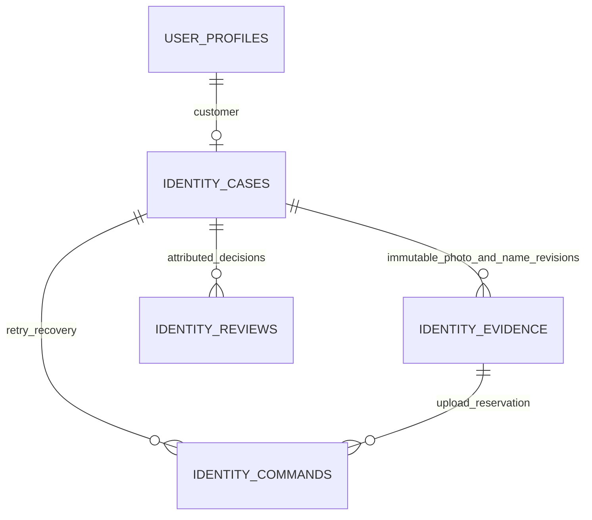

# Private reference photo flow

This slice implements customer reference collection/status and officer assistance/review for BR-01/BR-03 and TR-03/TR-06. It uses the existing Flutter app, NestJS API, PostgreSQL and private Supabase Storage. It does not perform face matching, liveness, document verification or transaction 2FA. **Reference accepted** is an enrollment milestone, not completed eKYC. AWS and the later comparison implementation remain undecided.

## Project defaults

These defaults are implementation decisions for the local coursework demo, not PDF rules:

- Notice version `reference-demo-v1` explains purpose, private access, the reference-only result and retention. Customers acknowledge it before starting. Assisted enrollment records that the officer obtained the customer's acknowledgement; it does not impersonate a customer login.
- An officer accepts only after confirming the selected customer's association with the reference. A correction needs a useful reason of 5–500 characters. The same officer may assist and review; no extra role, review queue or separate application is added.
- Evidence access expires seven days after a draft starts or restarts. Expiry prevents preview, submission and acceptance. The customer can start a new revision. A trusted maintenance command physically deletes expired files and uploads left pending for over 24 hours; this is not a continuously running deletion service. Decision/tombstone metadata remains for recovery and audit. Hosted retention and erasure policies remain open.
- Use agreed test images for this demo. Automated tests use generated coloured images, not faces. A synthetic customer name does not make a real photo synthetic; real-person capture needs an agreed test-data procedure.

## Customer and officer steps

1. Customer: open **Identity reference** from the profile workspace. Officer: select an existing customer, then open their **Identity reference**.
2. Read the notice, acknowledge it, and start a draft.
3. Capture/select a JPEG or PNG, inspect the preview, and retake/select again if needed. Save the photo privately, then submit it for review.
4. The customer sees **Awaiting officer review**. An officer opens the same customer's reference, previews the submitted photo and either confirms the association to **Accept reference**, or gives a reason to **Request correction**.
5. The customer checks status. A correction allows a new draft and photo; an accepted reference is read-only until it expires or a bound name change invalidates it.

In the web demo the button says **Choose photo**. Browser selection may offer a camera on supported devices; it is not proof of fresh capture. HTTP LAN camera access is not guaranteed. The native adapter requests a camera capture, but Android Studio/emulator execution is excluded from this work at the user's request. Android/iOS capture behavior needs separate device validation.

## Backend and recovery rules

Every call verifies the Supabase session and active server-controlled role. Customers access only their own reference; officers select an active customer. Files pass through NestJS, never a public URL or client Storage grant. Client-supplied roles, outcomes, object keys and unsupported fields are rejected. Evidence responses use `Cache-Control: no-store`.

The durable case states are `draft`, `submitted`, `needs_changes` and `reference_accepted`; absence of a case is `not_started`. Expired cases are presented as `needs_changes` with `expired: true`. Case version protects edits; reference revision binds the photo/name being reviewed. Reviewer attribution and decisions persist separately. Reference acceptance does not change profile status, account status, role or balance.

Uploads are limited to 10 MiB and one JPEG/PNG frame at most 4096×4096 pixels. The server decodes and re-encodes the image, removing EXIF/GPS and trailing data. The upload route alone allows the larger base64 JSON envelope; ordinary commands retain a small body limit. Storage keys and hashes are server-owned. Storage and PostgreSQL are reconciled through durable reservations rather than treated as one transaction.

POST commands require a UUID `Idempotency-Key`. Exact retries reconcile the same command; changed payloads or stale versions conflict. The app retains the pending command in memory and checks status after uncertain outcomes. Sign-out, confirmed session/role changes and process termination clear protected client state. A fresh login reloads durable server status. It does not restore unsent photos.

An officer-requested display-name change invalidates the reference in the same database transaction as the edit. Contact-only edits preserve it. Concurrent reviews cannot silently overwrite each other. An expired/unavailable photo cannot become a successful review.



`identity_cases` keeps current state/version. `identity_evidence` keeps private object metadata, the immutable photo/name revision and deletion tombstone. `identity_reviews` preserves officer decisions and system invalidations; `identity_commands` reconciles actor-scoped retries. These tables grant no direct client access. No face-check result table exists yet.

## Local checks and maintenance

Apply the additive migration using the existing setup flow; never reset the database. With local Supabase already running:

```powershell
npm --prefix backend run check
npm --prefix backend run format:check
npm run db:test
npm run check:identity-reference
```

The integration check starts its own API on a free port within 3001–3005, uses only local Supabase and temporary synthetic fixtures, then removes its generated private files and fixtures and stops that API. It does not stop an unrelated process or reset persistent demo users.

To remove eligible expired/pending private files with the configured backend credentials:

```powershell
npm --prefix backend run identity:cleanup
```

The command has no public HTTP route. It processes a bounded batch and records deletion only after Storage confirms it. Repeat if the batch limit is reached. Immediate expiry checks do not depend on this maintenance command running. A hosted schedule and production retention policy are not configured by this slice.

Use the local `run.bat` launcher for the interactive Edge demo. The user starts it; automated verification does not launch Android Studio or the emulator. [SETUP.md](SETUP.md) records verification results and limitations. [API.md](API.md) records the request/response contract.

## Verification record — 27 October 2026

- Backend lint/build/format checks and all **64 tests** passed. New checks cover role/route boundaries, strict fields, image limits/decoding, lost upload replies, existing-object hash reconciliation, unavailable Storage and failed deletion.
- All **115 database assertions** passed with synthetic fixtures rolled back. These cover restricted grants, private Storage, reference state constraints, immutable photo/name snapshots and atomic name-change invalidation.
- The real local Auth/API/PostgreSQL/Storage check passed after the final migration. Generated PNGs exercised private upload/preview, denied direct Storage access and cross-customer access, same-key retries, correction/resubmission, officer assistance, competing review rejection, restart persistence, name invalidation, expiry and physical cleanup. All temporary users, database rows and private objects were removed; the temporary API stopped. Existing local Supabase containers were left as found.
- Flutter analysis and all **80 local-workspace tests** passed. An exported staged snapshot also passed all **74 tests** without the six excluded local-preview tests. New checks cover API contracts, capture cancellation/denial, recovery, authoritative status messages, session clearing, customer submission and officer review. The web debug build succeeded using `config/browser.local.json`; it was not published or launched.
- Generated widget captures were visually inspected at 390 pixels and 200% text/keyboard: [customer submission](ui/reference-customer-fixture.png), [officer review](ui/reference-officer-fixture.png). These use a synthetic checker image and test state, not real biometric capture or an interactive browser session. A truncated large-text correction hint was fixed.

The user will run the interactive Edge demo with `run.bat`. No Android Studio/emulator or physical camera/iOS test was run. Reference collection and human review do not establish biometric accuracy, live presence or BR-03 completion. The shared policy directory was unavailable. Dependency audit still reports four high-severity entries rooted in Nest's existing pinned Multer dependency; this feature uses JSON uploads, not multipart handlers. The compatible body-parser dependency was refreshed; no forced framework upgrade was made.

## Remaining assignment work

The later high-value path still needs actual server-side one-to-one comparison against an accepted reference, bound to the exact operation. Every financial transaction still needs a separate second factor. The matching provider, thresholds, retry policy, second-factor mechanism and lecturer's expected eKYC depth remain open. Photo capture, human acceptance and generated fixtures do not complete those requirements. All seven business feature groups remain in [ROADMAP.md](../ROADMAP.md).
