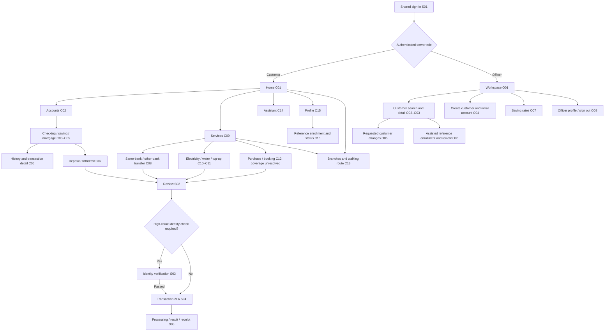

# Nene screen map

Status: screen inventory proposed on 2026-10-19; reference enrollment/status and officer review implemented on 2026-10-27. The lighter Open pocket direction is approved. Flutter implements sign-in, own initial checking-account/profile/contact views, officer customer creation/search/detail/requested edits and the [reference foundation](REFERENCE_FLOW.md). Actual face comparison, transaction 2FA and broader financial/map/chat layouts remain planned.

Source: [assignment PDF](../FinalProject_2026_2027.pdf), visually reviewed in full: p. 1 Business 1; p. 2 Business 2–7; p. 3 Technical 1–5. Requirement IDs follow [REQUIREMENTS.md](../REQUIREMENTS.md); interpretations follow [SCOPE.md](../SCOPE.md). Screen boundaries, labels, navigation, and reusable steps below are design proposals, not extra assignment requirements. This map supports TR-05/TR-06; screenshots alone do not complete a BR requirement.

## Navigation

One Android app, one sign-in screen. After authentication, the backend-provided active role determines the destination. No public signup, role picker, separate web dashboard, or officer app.

Customer bottom navigation: **Home · Accounts · Services · Assistant · Profile**. Home has shortcuts to transfer, bills, phone top-up, and nearby branches. History lives under accounts and is also reachable from Home and Assistant. Do not hide required account types in a carousel with no visible affordance.

Officer bottom navigation: **Workspace · Customers · Rates · Profile**. The same app presents a distinct role-appropriate destination. Identification assistance starts from the relevant customer record; a short list of incomplete enrollments can link back to those records, without introducing a support-ticket or multilevel approval system.

## Screen inventory and source traceability

IDs identify destinations or reusable steps, not an obligation to implement a separate widget/page for every row. Variants may share components while retaining distinct information and behavior.

| ID / destination | Entry and essential content/actions | Requirement / PDF source |
| --- | --- | --- |
| S01 Sign-in | Email, password, visibility toggle, sign in; provisioning guidance for users without access. Server role selects the next screen. No self-registration. | BR-01, BR-03; p. 1 §1, p. 2 §2 |
| C01 Customer home | Checking balance and account reference; links to all accounts; saving and mortgage summaries; recent transactions; common tasks and branch shortcut. No combined asset/debt total. | BR-05–BR-09, BR-11, BR-13; p. 2 §3–6 |
| C02 Accounts | Owned checking, saving, mortgage account list. Each opens its appropriate detail view. | BR-05; p. 2 §3 |
| C03 Checking detail | Own balance, currency, account reference, transaction history, allowed deposit/withdraw/transfer actions. | BR-05, BR-08, BR-09; p. 2 §3–4 |
| C04 Saving detail | Own balance, rate with unit, monthly monetary profit, calculation basis/effective date, history, operations allowed by the chosen policy. | BR-05, BR-06, BR-08; p. 2 §3 |
| C05 Mortgage detail | Mortgage information, amount due and due date for the chosen monthly or two-week convention, calculation basis and history. No loan application or underwriting. | BR-05, BR-07, BR-08; p. 2 §3 |
| C06 History / transaction detail | Account and month filters, amount/currency, direction, date, counterparty, status; open receipt/detail. Assistant links preserve the requested month. | BR-08, BR-14; p. 2 §3, §7 |
| C07 Deposit / withdraw | Two explicit actions; eligible account, amount, funding/destination mechanism under a documented policy; then S02–S05. | BR-08, BR-04; p. 2 §2–3 |
| C08 Transfer | Explicit same-bank and other-bank choices; source account, bank where relevant, recipient/account and amount; validated recipient, review and S03–S05. | BR-09, BR-04; p. 2 §2, §4 |
| C09 Services | Transfer; electricity; water; phone top-up; purchase/booking entry; branch finder. Purchases remain a planning placeholder until coverage is resolved. | BR-09–BR-13; p. 2 §4–6 |
| C10 Electricity / water | Separate category entry, bill/customer reference, lookup, bill details and amount, funding account, S02–S05. | BR-11, BR-10, BR-04; p. 2 §2, §4–5 |
| C11 Phone top-up | Phone account/provider and amount, funding account, S02–S05, fulfillment outcome. | BR-11, BR-10, BR-04; p. 2 §2, §4–5 |
| C12 Purchase / booking | Preserve flight tickets, movie tickets, hotel rooms and e-commerce products as unresolved category coverage. Chosen coverage needs selection/quote, required booking details, review, payment and fulfillment result. Reuse provider flow; do not build four marketplaces. | BR-12, BR-10, BR-04; p. 2 §2, §4–5 |
| C13 Branch map / walking route | Location permission, user marker, all nearby offices in declared coverage, nearest-office recommendation, shortest walking route and distance. Manual area browsing may help when location is denied but does not replace the required location demonstration. | BR-13; p. 2 §6 |
| C14 Assistant | Chat messages and linked activities: bills, phone services, month-filtered history. Validate destinations and ownership; financial links open ordinary review/verification. | BR-14; p. 2 §7 |
| C15 Customer profile / edit | Own information, phone/address edits and sign out are implemented. Identity reference opens the implemented C16 flow. Name/email/account/rate/role fields are not customer-editable. | BR-01–BR-03; p. 1 §1, p. 2 §2 |
| C16 Reference enrollment / status | [Detailed map](IDENTITY_VERIFICATION.md): status -> instructions/notice -> one reference photo -> review -> submission -> officer acceptance or correction. Officer-assisted capture is available. Display “Reference accepted,” never “eKYC complete”; acceptance prepares the reference for a later comparison. Define notice and retention/deletion policies before evidence collection. | BR-03; p. 2 §2 |
| S02 Review operation | Account, recipient/biller, amount/currency, any applicable fee and total; edit/cancel or continue. Editing invalidates prior authorization. | BR-04, BR-08–BR-12; p. 2 §2–5 |
| S03 High-value identity check | Show the operation being checked; capture a new photo for an actual server-side one-to-one comparison against the accepted reference. Handle missing reference, failure/retry/cancel and unavailable comparison without authorizing the operation. Threshold, comparison implementation/provider and attempt policy remain open. Does not replace S04. | BR-03; p. 2 §2 |
| S04 Transaction 2FA | Verify the exact operation before posting. Method-neutral design until selected. If OTP: delivery guidance, expiry, resend/retry limits and invalid/reused/mismatched handling. | BR-04; p. 2 §2 |
| S05 Processing / result / receipt | Processing, completed, rejected, cancelled or unknown status; stable reference, amount/currency, date and next action. For integrations, distinguish payment status from fulfillment; use provider checkout/return when required. No success until authoritative confirmation. | BR-04, BR-08–BR-12; p. 2 §2–5 |
| O01 Officer workspace | Create customer primary action; customer search; continue assisted identification; savings-rate entry. No unrelated financial analytics or approval inbox. | BR-01–BR-03, BR-06; p. 1 §1, p. 2 §2–3 |
| O02 Customer search | Authorized name/email search in Flutter, also phone through the API; results or empty/error state, then select a record. Queries are limited to 100 characters and 20 matches. Supports requested edits now and identification assistance later. | BR-01–BR-03; p. 1 §1, p. 2 §2 |
| O03 Customer detail | Identity/profile, banking accounts, enrollment status; requested edit, account provisioning and identification assistance entry points, each permission-checked. | BR-02, BR-03, BR-05; p. 1 §1, p. 2 §2–3 |
| O04 Create customer / account | Capture permitted customer fields, review, create authentication identity plus profile and initial banking account; show safe activation/access instructions. Do not expose administrative secrets or silently mark eKYC complete. Account creation is distinct from depositing funds. | BR-02, BR-03, BR-05; p. 1 §1, p. 2 §2–3 |
| O05 Requested customer change | Customer context, permitted field edits, review changes and save/result; record request context/audit metadata without a new ticket product. | BR-02; p. 1 §1 |
| O06 Assisted reference enrollment / review | [Detailed map](IDENTITY_VERIFICATION.md): selected-customer status, assisted capture/submission of one photo, private evidence review, explicit decision confirmation/result. Accept the reference or request correction; acceptance does not assert an electronic identity match or completed eKYC. | BR-01, BR-03; p. 1 §1, p. 2 §2 |
| O07 Saving rates | Current applicable rate/unit, scope and effective date; edit, review effect and confirm under documented bank policy. | BR-06; p. 2 §3 |
| O08 Officer profile | Current officer identity and sign out; no client role editor. | BR-01, BR-03; p. 1 §1, p. 2 §2 |

## Critical journeys

1. **Implemented local first flow:** officer signs in → O04 creates a synthetic customer/profile/zero-balance VND checking account → customer signs in → own profile/account → phone/address edit persists. Officer search/detail also supports requested name/contact changes with a reason. Backend permissions and stable creation keys protect the flow. Identity remains unverified and financial actions remain unavailable. Hosted activation is separate work.
2. **Money movement:** C07/C08 → S02 → S03 when policy requires → S04 for every financial transaction → backend validation/posting → S05 → C06. Failed, expired or cancelled verification cannot change balances. No low-value 2FA exemption.
3. **Utilities:** C10/C11/C12 → quote/details → S02–S05 → payment status and separate fulfillment result. Provider integration and interbank transfer are separate capabilities; neither is proved by a static success screen.
4. **Assistance:** C14 request for a particular month's history → C06 with that month and permitted account context. Bill/top-up requests open their normal flows. The chatbot never authorizes a payment.
5. **Nearby office:** C13 location permission → nearby offices → nearest office under chosen metric → shortest walking route. Handle permission denial and missing routes without substituting driving directions.
6. **Reference enrollment and officer review (implemented foundation):** C15 → C16 status/notice/photo/review/submission → O06 private reference review → reference accepted or correction requested. O03 → O06 also supports officer-assisted collection. Enrollment states are `not_started`, `draft`, `submitted`, `needs_changes` and `reference_accepted`; none means completed eKYC. Later, S03 still needs an actual server-side comparison for the specific high-value operation; S04 remains required and unimplemented for every financial transaction. See [the implementation and verification limits](REFERENCE_FLOW.md) and [full design boundary](IDENTITY_VERIFICATION.md).

## State and recovery contract

| Screen family | Loading / empty | Error / cancellation / confirmation |
| --- | --- | --- |
| Sign-in | Keep labels and submit position; show signing-in progress and prevent duplicate submission. | Invalid credentials: generic inline guidance; unavailable service: retry; inaccessible profile: clear access message; expired session returns to sign-in. Never reveal whether a given email exists. |
| Home / accounts / history | Skeleton or explicit loading; never render a missing balance as zero. No accounts: explain officer provisioning. No transactions: explain empty history; filtered empty state offers clearing the filter. | Keep account-specific failures distinct; retry failed reads. Display stale amounts only if clearly marked and prevent invalid actions; preview uses a full error state. |
| Customer/profile forms | Preserve non-sensitive input across recoverable failures; no fake customer results. | Field validation adjacent to fields, cancel/back behavior, review meaningful changes, save/result. Do not claim success before persistence. |
| Reference enrollment / identity check | Show photo upload and officer review status separately from the later operation's comparison result; missing reference has a next step. | Denied camera permission, failed upload, correction request, unavailable comparison or failed match with safe retry instructions; private evidence and permission-checked access. Camera capture alone does not prove live presence; document replay/spoof limits. |
| Transaction / provider | Explicit pending status; preserve operation reference. | Insufficient funds, invalid recipient, denied action, rejected 2FA, provider cancellation/failure. Unknown outcome: check the existing operation, never suggest making a new payment blindly. |
| Officer | No search query vs no results vs no pending enrollments; distinguish each. | Unauthorized access, duplicate customer, create/edit failure, conflicting rate change; review before committing. Don't turn reference acceptance into a passed identity check. |
| Map / assistant | Location or response loading; no nearby office, no route or no answer. | Permission guidance, retry, unsupported area/query. Invalid activity links fail safely; they must not open unauthorized data. |

The table describes the target state contract across the full app. [The HTML UI study](UI_DIRECTION.md) draws three representative screens with manual fixtures. Flutter separately implements first-flow loading, empty, error, creation-review and save-result states; it does not implement the study's full financial navigation.

Creation correction is available after validation `400` or confirmed duplicate-email `409` with `CUSTOMER_EMAIL_EXISTS`. Uncertain outcomes retain the same key/body for retry. Ordinary background/resume and same-user token refresh preserve that in-memory state; confirmed session/permission changes or process termination clear it. See [CUSTOMER_FLOW.md](CUSTOMER_FLOW.md) for recovery limits. [IDENTITY_VERIFICATION.md](IDENTITY_VERIFICATION.md) now maps proposed identity content, state/recovery and backend rules; rendered identity screens and their implementation checks remain open. Financial, map and chat screens still need detailed layouts and implementation checks.

## Decisions before dependent implementation

- First-flow profile permissions and VND/zero-balance checking defaults are recorded in [CUSTOMER_FLOW.md](CUSTOMER_FLOW.md). Define remaining account operations/funding methods, calculation/rounding rules, rate-effective dates and mortgage frequency before their implementation.
- Use the simplified officer-assisted photo reference flow. Define the short notice, retention/deletion and officer confirmation policies before evidence collection. Select the later server-side comparison implementation/provider, high-value threshold and attempt policy, plus the separate transaction-bound 2FA method before their dependent financial flows. AWS remains undecided; liveness, native bridges, OCR/NFC and commercial KYC are not mandatory enrollment steps. Preserve the PDF's eKYC outcome and clarify any simulated demonstration with the lecturer.
- Clarify BR-12 category breadth and lecturer acceptance of external service sandboxes/simulations. Keep all named alternatives in planning until settled.
- Define branch dataset, coverage/radius and nearest-office metric, then prove walking-route access.
- English remains the current UI language. VND and a zero-balance initial checking account are provisional first-demo decisions in [CUSTOMER_FLOW.md](CUSTOMER_FLOW.md), not PDF rules or a permanent restriction to one account type/currency. The HTML study's people, balances and dates remain synthetic fixtures.

Explicit exclusions remain those in [SCOPE.md](../SCOPE.md): no card issuance, QR payment, budgets, spending analytics, notification center, support tickets, loan origination, separate admin/web app, or additional iOS release.
