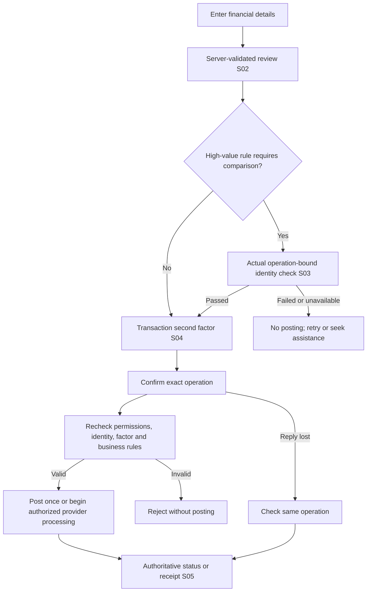

# Transaction confirmation and 2FA plan

Status: **planning only, 27 October 2026**, requested after the reference-photo slice. No transaction endpoint, balance write, OTP delivery, authenticator enrollment or financial UI is implemented by this plan. Flutter + one NestJS API + Supabase remains the stack. AWS and the face-comparison provider remain undecided.

The proposed shared journey is **enter details → review → high-value identity check when required → transaction 2FA → authoritative result**. Reuse it across financial features rather than building a different security flow for each payment category.

## Assignment boundary

The [PDF](../FinalProject_2026_2027.pdf), p. 2 Business 2–5, and [requirement register](../REQUIREMENTS.md) establish the outcomes below. Labels, state names, API shapes and limits in this document are project proposals, not lecturer-approved rules.

| Requirement | Required outcome | Planning consequence |
| --- | --- | --- |
| BR-03 | eKYC/officer assistance and the example's high-value identity-check intent. | Preserve the separate actual comparison gate. A reference accepted by an officer is not a passed comparison for an operation. |
| BR-04 | All transactions pass 2FA before persistence; OTP is an example. | Require a second factor for every financial operation. There is no low-value, deposit, same-bank or previously-verified-session exemption. |
| BR-08/BR-09 | Deposits, withdrawals, history, and allowed/valid transfers before database persistence. | Validate business rules independently of 2FA; keep authorization, balances and posted records consistent. |
| BR-10–BR-12 | Payment integration, bills, top-ups and purchase/booking payments. | Reuse the review/authorization steps; provider settlement and fulfillment need their own later integration rules. |
| BR-01/BR-14 | Role separation and activity-linked chat. | Officers and chat links cannot approve or execute a customer's transaction on their behalf. |
| TR-03/TR-05/TR-06 | Persistence and explainable data, flows and UI. | Record actual implementation/verification evidence later. This document is design evidence only. |

Coverage includes deposits, withdrawals, same-bank and other-bank transfers, electricity/water payments, phone top-ups and the purchase/booking categories still awaiting lecturer interpretation. Funding/cash-out mechanisms, eligible account types and external-provider access remain unresolved; this plan does not turn a deposit into an unrestricted balance-credit endpoint.

Account reads, contact edits, zero-balance account creation, reference review, rate-policy editing, savings-profit display and mortgage-due calculations are not automatically financial postings. Do not add automatic interest credits, scheduled mortgage debits, a general accounting product or a new officer payment role to exercise 2FA.

**Persistence interpretation remains open:** storing an unposted intent/challenge for recovery is different from persisting a completed financial transaction. The brief does not define that lifecycle. The schema below proposes the distinction; confirm the lecturer's interpretation before implementing durable pre-authorization records. No balance change or posted financial transaction may precede the required checks.

## Customer screen sequence

| Screen | Essential content/actions | Failure and recovery |
| --- | --- | --- |
| Input: existing C07/C08/C10–C12 | Select own eligible account, destination/bill/phone/order and amount where applicable. **Review** sends details for backend validation. | Invalid amount, unsupported account/currency, invalid destination or unavailable quote stays here with useful feedback. Do not display another customer's balance or full profile. |
| S02 Review | Server-returned operation type, relevant debit/credit account(s), funding/destination details appropriate to the operation, confirmed recipient/biller, amount/currency, fee if any, total debit/credit and expiry. **Edit**, **Cancel**, **Continue**. | A changed destination, amount, currency, fee or quote needs a new review and invalidates earlier authorization. Client-calculated totals are not authoritative. |
| S03 High-value identity check, conditional | Show the same amount/destination and request a new capture for actual comparison against the accepted reference. | Missing/expired reference, failed/unavailable comparison or stale identity revision blocks progress. Route back to reference assistance when appropriate; no officer override or fake pass. Threshold and matching method remain open. |
| S04 Transaction 2FA, always | Keep the reviewed amount/destination visible; show the selected factor's instructions and one code field if applicable. **Confirm transaction** is the deliberate final instruction. | Wrong/expired code, attempt limit, unavailable factor and changed details never imply success. TOTP has no **Resend code** action; a delivered-code alternative would need one. Preserve non-sensitive review context, never persist entered codes. |
| S05 Processing/result | Stable operation reference; confirmed success/receipt, explicit rejection, or processing. **Check status**, **Back to accounts**, **View history** when applicable. | Lost replies show **Outcome not confirmed — check status**. Never recommend a new transfer to resolve uncertainty. An external payment may remain processing; payment completion and fulfillment are separate. |

Preserve the approved ivory/teal/apricot theme, existing logo and one-column phone layout. Use readable formatted VND amounts backed by integer minor-unit strings, persistent labels, at least 48-pixel targets, keyboard-safe scrolling and 200% text wrapping. The final button must name the financial action/total clearly; an OTP instruction must not masquerade as ordinary sign-in.

The first financial implementation should be one **same-bank checking-account transfer** with explicit synthetic test funding and no external provider. This is a delivery order, not permission to omit deposits, withdrawals or later feature groups. It remains blocked until the account rules and authorization gates below are resolved; existing zero balances are not silently changed to make a demo work.

## Second-factor recommendation for review

**Evaluate authenticator-app TOTP through existing Supabase Auth first.** It avoids adding an SMS/email delivery provider to this stack and avoids implementing our own TOTP secret storage/algorithm. The trade-off is customer enrollment, an authenticator app and deliberate recovery handling. This is a recommendation and compatibility test target, not a confirmed mechanism or enabled feature. The current local configuration disables TOTP enrollment/verification.

| Option | Fit and trade-off |
| --- | --- |
| Supabase TOTP | Existing provider supports enrollment and challenge/verify, including Flutter. The customer enters an authenticator code; Nene must still bind the verification to the exact operation. Preferred option to evaluate. |
| Application-issued email OTP | A code can be generated for one operation, but adds delivery, verified-address, abuse and code-verifier responsibilities. Existing local Inbucket is a developer mail sink, not proof of access to a separate customer mailbox. Supabase email login OTP is not a transaction-authorization mechanism. |
| SMS OTP | Adds phone verification, delivery/provider setup, cost and SIM-related risks. Not required by the PDF and not the proposed first path. |

Supabase's documented MFA API takes factor/challenge identifiers and a code; it does not take Nene's amount or recipient. A verified factor or `aal2` session therefore cannot be treated as reusable permission to post transactions. This is an architectural inference from its documented contract, not a claim that Nene integration has been tested. [Supabase TOTP guide](https://supabase.com/docs/guides/auth/auth-mfa/totp), [challenge](https://supabase.com/docs/reference/javascript/auth-mfa-challenge), [verify](https://supabase.com/docs/reference/javascript/auth-mfa-verify), [Flutter challenge/verify](https://supabase.com/docs/reference/dart/auth-mfa-challengeandverify).

Before selecting TOTP, prove locally that NestJS can create/verify a factor challenge for the authenticated user, associate it with one intent version, reject reused successful codes/challenges across operations, and handle concurrent/uncertain results. Test returned-session/token rotation and challenge/verify IP behavior with request-scoped provider access. Never infer success from a client boolean, a previous login verification or an unexamined JWT claim. The direct Supabase factor APIs must not provide a banking bypass. If the installed version cannot meet these rules, retain a blocked transaction flow and revisit the method rather than inventing success.

Research caveat: a review of the current upstream [TOTP verification path](https://github.com/supabase/auth/blob/master/internal/api/mfa.go) and [factor model](https://github.com/supabase/auth/blob/master/internal/models/factor.go) did not establish cross-challenge successful-code consumption. This is not a tested finding about Nene's pinned runtime. Explicitly reuse one successful code against a different challenge and operation, including concurrently; different challenge IDs alone are not evidence of replay protection. Ordinary TOTP is time/secret based, so it does not intrinsically encode payment details. [RFC 6238](https://www.rfc-editor.org/info/rfc6238/).

### Minimum factor setup, if TOTP is selected

Add one customer **Transaction security** entry under Profile: explain the authenticator requirement, reauthenticate before first setup, show a transient QR/setup secret, verify the first code, then mark the factor enrolled. Enrollment confirmation is not authorization for a payment. Never write QR secrets or codes to logs, analytics, source control, screenshots or ordinary app storage. Use request-scoped provider access on the server; do not put one user's mutable Auth session into a shared global client.

Changing/removing a factor requires the existing factor plus appropriate reauthentication; an ordinary officer contact/name edit must not reset it. Losing the factor blocks financial confirmation. Hosted recovery remains to design before hosted financial activation. Controlled reset of an explicitly synthetic local fixture is a test-maintenance action, not a customer recovery feature. Do not add an SMS/email fallback or bypass automatically.

## Backend rules and proposed state

One NestJS transaction module owns orchestration; ordinary Flutter repositories/controllers own presentation. Keep provider access out of widgets and banking tables out of direct client data APIs. No extra backend, queue service or microservice is implied.

The server binds the operation ID/version to the active customer, relevant debit/credit account(s), operation-specific funding/destination/order details, operation kind, amount/currency, fee/total, quote expiry, required identity rule/reference revision and factor challenge. Use a stable authenticated session identifier if session binding is selected; ordinary same-user token rotation must not silently create a new operation. All significant values are canonical server data. These application rules follow the separation between authentication and transaction authorization described by [OWASP's transaction authorization guidance](https://cheatsheetseries.owasp.org/cheatsheets/Transaction_Authorization_Cheat_Sheet.html).

Keep a small intent lifecycle: `awaiting_authorization`, `processing`, then `completed` or `rejected`; `cancelled` and `expired` are terminal before processing. Identity/factor prerequisites are separate statuses on the intent, not additional top-level workflows. **Unknown outcome** is a client's lack of a confirmed reply, not an invented completed/rejected database result.

- Store immutable reviewed details; edit by cancelling/superseding the old unprocessed intent and creating a newly reviewed version. Invalidate its identity/factor proofs. Do not carry authorization onto a changed quote or destination.
- Authenticate and check ownership on every read/command. Role, account activity, supported operation/account/currency, destination, positive integer amount, applicable fees and available funds are checked before review and again before posting. Successful 2FA does not reserve a balance or guarantee a payment will succeed.
- Require the accepted, unexpired reference under the current proposed project policy for financial posting. High-value activity additionally requires a real operation-bound comparison. Missing high-value configuration or an unavailable required check fails closed; leave posting disabled until the policy is defined.
- Issue at most one active challenge per intent version. Bind it to the owner/factor and exact reviewed details; replacements invalidate older attempts. Retry keys must retain command scope and payload identity without storing raw codes. If proof fingerprints are needed, use a protected keyed mechanism with bounded retention, not a plain hash of a low-entropy code. A code passing elsewhere cannot set a global `twoFactorVerified` flag.
- Reserve attempts atomically before contacting the factor verifier, and serialize completion/cancellation for the same operation. Protect against concurrent code guessing and replay across different operations. A duplicate confirmation returns the original operation result, not a second transfer.
- Provider verification and PostgreSQL are not one transaction. Persist a server-observed verification result for the specific pending attempt before financial execution; if its outcome cannot be proven after a timeout/crash, do not post. Reconcile the same operation. Before permitting a fresh challenge, supersede/invalidate the unresolved attempt so its late success cannot authorize posting; replay controls still apply. A provider-side success without a durable local result is not permission to guess that payment succeeded.
- For local transfers, lock the necessary account/intent records in a stable order, recheck preconditions and commit debit, credit, transaction history, authorization consumption and completed result in one PostgreSQL transaction. A unique operation/transaction association prevents duplicate posting. No partial debit or phantom receipt.
- Once an operation starts processing, a cancel request cannot pretend to reverse it. Before processing, cancellation invalidates outstanding challenges. A cancel/confirm race must have one authoritative winner.
- External processing later uses a stable provider idempotency/reference and deduplicated authenticated callbacks. Decide fund reservation/settlement/release and timeout reconciliation before enabling it. A checkout redirect alone is not success, and local DB/provider updates are not atomic.

Proposed records are an `OperationIntent`, associated identity/factor attempts, and the eventual posted transaction/history. Keep only the IDs, canonical details, versions, deadlines, attempt counters and minimal audit/recovery metadata needed. Successful comparison records remain a separate future identity feature. Passwords, OTP values, authenticator secrets and biometric images do not belong in transaction records or logs.

## Candidate API, not implemented endpoints

All routes are under `/api/v1`, authenticated, customer-owned and `no-store`. POST commands use scoped UUID idempotency keys. [API.md](API.md) remains the implemented contract; these routes must not be reported as available.

| Route | Intended purpose |
| --- | --- |
| `POST /me/operation-intents` | Validate supported financial details and return canonical review, version, expiry and required checks. No posting. |
| `GET /me/operation-intents/:id` | Authoritative current state and allowed actions; recover a lost response without starting a new payment. |
| `POST /me/operation-intents/:id/second-factor/challenges` | Create/reconcile a challenge for the reviewed version after applicable identity prerequisites. Never return a usable OTP or authenticator secret. |
| `POST /me/operation-intents/:id/confirm` | Expected version, recorded challenge ID and factor proof; verify/reconcile it and post or begin provider processing only after all gates pass. Client flags cannot assert a pass. |
| `POST /me/operation-intents/:id/cancel` | Cancel only an unprocessed version; invalidate its checks. |

Missing/invalid authentication, denied role/ownership, invalid details, stale state, attempt limits and dependency failure need distinct safe responses (`401`, `403`/indistinguishable `404`, `400`, `409`, `429`, `503`). A timeout never silently creates a replacement key. Do not return full provider errors, financial data belonging to another customer or secrets.

## Proposed small limits, still to confirm

| Policy | Starting proposal | Boundary |
| --- | --- | --- |
| Review/intent lifetime | 10 minutes, shortened by any earlier quote/reference expiry. | No lifetime extension from repeatedly reopening the screen. |
| Authorization attempt | At most 5 wrong proofs, then require a new reviewed intent. | Add a customer/factor-wide rolling cap so new intents do not reset brute-force protection; proposed 10 failures in 15 minutes. Concurrent requests share the budget. |
| Fresh authorization result | At most 2 minutes, also bounded by intent/quote/identity/factor expiry. | Consumed by exactly one operation; no transferable browser or session permission. |
| TOTP validity | Use the selected provider's actual documented/enforced time step and tolerance. | Do not invent a five-minute lifetime or a resend button for authenticator codes. Prove successful-code replay rejection. |
| Delivered-code alternative | Only if selected later: propose 6 random digits, 5-minute expiry, 60-second resend delay and at most 3 issues per intent. | A replacement invalidates the old code; attempts/rolling limits cannot be reset by resend. Not a confirmed factor/channel. |
| High-value threshold | **Open.** Server-owned policy, boundary tested once chosen. | No arbitrary money amount is introduced by this plan. |

These are design proposals. Before implementation, resolve the intent-storage interpretation, factor choice and replay behavior, concrete attempt policy, high-value rule, and first transfer's account/funding rules. More complicated provider or transaction machinery should be added only when a required operation needs it.

## Acceptance evidence and delivery order

1. Review the S02–S05 screen/state contract and resolve the small policy decisions above. A labeled UI fixture can demonstrate layout and recovery, but not a completed transfer or BR-04.
2. If accepted as the next method to evaluate, prove Supabase TOTP enrollment/challenge/verify and transaction-specific replay/recovery behavior using synthetic local users. Keep AWS and the face matcher undecided; do not send messages or create paid accounts as a side effect.
3. Build the review/intent and confirmation path for a same-bank checking transfer only after its prerequisites are ready. Until the necessary identity/2FA checks exist, keep execution unavailable rather than enabling a bypass. Test-only synthetic balances are fixtures, not customer-accessible funding functionality.
4. Expand the same reviewed authorization path to the remaining required operations as their policies/integrations are implemented. Record provider simulations and lecturer acceptance limits honestly.

Required future tests: customer isolation and officer denial; malformed/zero/negative/unsupported amounts; wrong recipient/currency; insufficient funds and concurrent debits; changed amount/fee/destination/reference; missing/failed/expired high-value match; wrong/expired/reused/wrong-operation factor; cross-operation TOTP replay; attempt/resend throttles; double confirm; cancel/confirm races; crash/lost reply/provider-verify uncertainty; no partial balances/history; provider callback replay and fulfillment separation; sign-out clearing, status recovery, narrow screens/large text/keyboard and denied capture where relevant.

Use the Edge web demo for interactive review; the user starts `run.bat`. Do not launch Android Studio/emulators. Later Android delivery remains required by the assignment, and native/platform acceptance is still open. This planning task adds no runtime tests or app behavior. The shared policy directory was unavailable; the original PDF/rubric and local-only runner changes remain intact.

Planning review on 2026-10-27 rechecked PDF page 2 visually, cross-checked the requirement register and screen map, and reviewed the linked official MFA contracts and upstream source. Independent scope and factor reviews informed this plan. These are documentation/research checks, not evidence that TOTP or financial execution works in Nene; the compatibility tests above remain outstanding.
