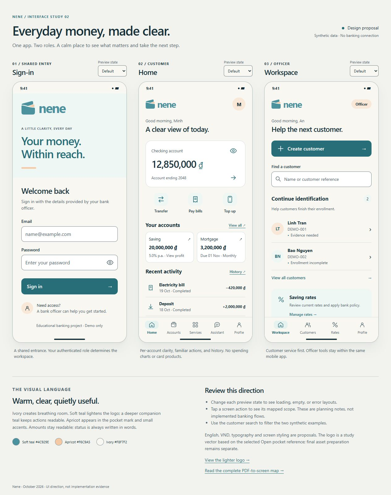

# Nene UI direction study

Status: lighter visual direction approved on 2026-10-19; implementation status updated 2026-10-20. Flutter uses it on sign-in, role-specific workspaces, profile/checking-account display, customer contact edits, officer creation/search/detail/requested edits, and loading/unavailable states, with an Android launcher icon. The wider home/workspace layouts below remain design studies. All sample identities, references, dates, amounts and rates in the HTML study are synthetic fixtures, not app data or integration evidence.

Revision 02 follows the user's request to lighten both the screens and logo; the user approved this version. [View the lighter logo](ui/logo.html).

[Open the interactive study](ui/index.html) · [Complete screen map](SCREEN_MAP.md) · [Brand reference](BRANDING.md)

The HTML is a self-contained, local design artifact, not a new web banking product. Open `docs/ui/index.html` in a browser. It loads only local CSS, JavaScript and an SVG. It has no API access, analytics, remote fonts or persistence; its content security policy disables connections and form submission. Do not enter real credentials. Screen actions open planning notes, not implemented financial flows.

## Three representative screens

| Screen | Direction and scope | Review artifact |
| --- | --- | --- |
| Shared sign-in | Large Open pocket mark, short welcome, persistent email/password labels, one primary sign-in action and officer-provisioning guidance. Role comes from authenticated server data; no role picker or self-signup. BR-01/BR-03. | [Sign-in](ui/index.html#signin) |
| Customer home | Checking balance first, common actions next, separate saving/mortgage summaries, recent history and a branch shortcut below. Five destinations: Home, Accounts, Services, Assistant, Profile. No asset/debt aggregation or financial analytics. BR-05–BR-09/BR-11/BR-13. | [Customer home](ui/index.html#home) |
| Officer workspace | Create customer as the main action; find a customer, continue incomplete identification, access savings-rate management. Four destinations: Workspace, Customers, Rates, Profile. One mobile app, with a distinct officer interface. BR-01–BR-03/BR-06. | [Officer workspace](ui/index.html#officer) |

Phone frames are approximately 390 × 844 CSS pixels on the desktop board. Content scrolls within them; bottom navigation stays reachable. Some secondary content is intentionally below the first viewport. Small displays stack the three studies vertically. The customer account summary is not the complete account-detail layout: saving details must show monthly monetary profit, and mortgage details must show the chosen repayment convention and due amount.

## Visual direction and implementation status

- **Surfaces:** warm ivory page, white form/account surfaces including the checking summary, pale teal supporting surfaces, and limited action-teal controls. Use open spacing and modest rounding, not a card around every paragraph.
- **Apricot:** retain the logo insert and small emphasis details. Do not use apricot text on ivory or rely on an apricot outline to identify an essential control. Officer/customer avatar tints are decorative.
- **Typography:** use a familiar system sans for the study, with 23–25px screen titles, 32px balance, 16px inputs, 14–16px main copy and 12px secondary copy. Compact navigation labels are 11px. Browser rendering uses Segoe UI/Arial; Flutter uses platform typography with text-scaling checks for the implemented forms. No font package is added. The plain `nene` text beside the mark is a study lockup, not approved production wordmark lettering.
- **Numbers and language:** separate amounts by account type and write status in words. English is the current UI language. The first Flutter account uses VND and integer grouping without fractional units; the HTML's nonzero amounts remain fixtures. Other currency and savings/mortgage calculation policies remain open. These choices do not add multilingual or multi-currency requirements.
- **Controls:** consistent outline icons, labeled actions, visible keyboard focus, neutral secondary actions and action-teal (`#286E78`) primary controls. The lighter logo teal (`#4C929E`) is not used behind white button text or for small UI text. Proposed Flutter touch targets should be at least 48 logical pixels. Final platform accessibility must be verified in the implementation.
- **Tone:** short, calm instructions. Missing data is not zero; uncertain financial outcomes are not success. Errors explain a next action without exposing provider or database internals.

The code-authored [study SVG](ui/open-pocket-study.svg) follows the selected main B reference: upright body, rising rear fold, curved opening and apricot insert. It is used to keep the mockups consistent. It is not a finalized production master, launcher asset, approved wordmark, or a new trademark assessment. Production geometry, clear space, small-size and launcher-mask checks remain on the roadmap.

## Preview interactions

- Each screen's **Preview state** selector exposes default/loading/error; customer and officer also expose empty states. They are manual fixtures and do not call services.
- Sign-in provides a password visibility toggle. Submitting displays a preview-only message and does not authenticate or transmit/store input.
- Customer home can hide/show the checking amount. Account, service, history, branch and assistant actions open requirement-linked notes.
- Officer search in the HTML filters two synthetic examples. Flutter's separate first flow now calls NestJS for authorized customer search and local synthetic provisioning; the HTML does not connect to it.
- Planning-note dialogs support Escape and restore focus to the initiating control. The state “Try again” action returns to the default fixture; it does not imply server recovery.

## Verification record

Initial interaction/layout checks on 2026-10-19 used a temporary headless Microsoft Edge browser and local files. Those checks are retained for unchanged behavior. Revision 02 was visually reviewed and captured through the in-app browser, with rendered color inspection and recalculated contrast:

- Reviewed all three original PDF pages visually and extracted their text; mapped all BR-01–BR-14 to destinations/journeys in [SCREEN_MAP.md](SCREEN_MAP.md). No original assessment file was modified.
- Rendered and visually inspected the three default screens, error/empty examples and narrow layout. Loading states and all selector changes were exercised. No page JavaScript errors or external requests occurred.
- At 1440, 768, 390 and 320px viewport widths, neither the page nor phone content areas had horizontal overflow. At 390px, a 200% text-size stress check had no horizontal overflow in the scrollable content regions, but crowded/clipped the fixed bottom-navigation labels. An adaptive large-text navigation treatment is required before app implementation; this study does not pass a full 200% accessibility review.
- Exercised search match/no-match/reset, hide/show balance, password visibility, loading submit disablement, screen-map dialog opening, Escape closure and focus restoration. All buttons had visible text or accessible labels.
- Revision 02 solid-color text pairs, using WCAG relative luminance: white/action teal **5.85:1**, action teal/ivory **5.45:1**, balance ink/white **14.00:1**, secondary ink/white **6.41:1**, secondary ink/pale teal **5.89:1**, action teal/avatar tint **4.86:1**. These text pairs exceed 4.5:1. Unchanged error text/ivory remains **6.67:1** and input border/white **3.99:1**. Soft logo teal on ivory is **3.31:1** and on pale teal **3.26:1**; use it only for the mark and large brand lettering, not small text. Light apricot/ivory is **1.42:1**, so apricot is decoration, not an essential icon or text color.
- Reviewed Markdown links and Git diff before publishing. No application tests were needed for this isolated design/documentation change; no application behavior changed.

Flutter verification is recorded in [SETUP.md](SETUP.md). The first customer flow passes analysis and 54 mobile tests, including sign-in/creation at 200% text with keyboard insets on a small phone, role boundaries, protected-page clearing, exact creation retries and background/resume preservation. The backend and database checks are recorded separately there. Flutter displays actual API-backed checking accounts and provides local officer provisioning and permitted edits. The HTML's fixed bottom navigation, sample balances/history, saving/mortgage summaries and financial controls remain unimplemented. Reference assistance/review is now implemented separately in the Flutter workspace; see REFERENCE_FLOW.md. Still to verify: remaining screen layouts, final wordmark, full screen-reader traversal, large-text navigation once implemented, and actual financial/security behavior. Banking/provider choices and lecturer interpretations remain in [SCREEN_MAP.md](SCREEN_MAP.md) and [SCOPE.md](../SCOPE.md).

## Next implementation boundary

The [first local officer-to-customer journey](CUSTOMER_FLOW.md) is implemented. The [identity verification map](IDENTITY_VERIFICATION.md), simplified 2026-10-27, details customer reference enrollment/status and officer assistance/review using this approved palette. It adds no rendered screens or application behavior.

The [reference foundation](REFERENCE_FLOW.md) now implements provider-neutral photo selection/capture, private storage, clear status and officer acceptance/correction in the same Flutter workspace. Its local demo notice and retention defaults are documented there. It uses “Reference accepted,” not “Verified” or “eKYC complete.” The sequence follows `not_started`, `draft`, `submitted`, `needs_changes` and `reference_accepted`; it does not depend on liveness, a native provider bridge or an AWS decision. The web demo is the interactive review target; native camera behavior remains to validate.

The later high-value flow still needs an actual server-side one-to-one comparison against the accepted reference, with honest replay/spoof limits and a separate result for the operation. Its implementation/provider remains undecided. Every financial transaction also requires transaction-bound 2FA. Hosted activation and the remaining account types stay open. Keep all later PDF features in the roadmap.

## Planned transaction confirmation and 2FA

[TRANSACTION_FLOW.md](TRANSACTION_FLOW.md), mapped on 2026-10-27, defines shared review, conditional high-value identity check, transaction 2FA and result/recovery content for S02–S05. It adds no rendered financial screen or app behavior. Keep the approved lighter colors and show the server-reviewed amount/destination through confirmation; do not introduce fictional balances or success receipts as real data.

Supabase authenticator TOTP remains the working candidate after the isolated provider and backend-safeguard experiments; customer integration and factor selection remain open. The [authenticator lifecycle plan](AUTHENTICATOR_LIFECYCLE.md) details one Profile → Transaction security feature: status, fresh password, QR/manual key, first-code check, replacement, conditional one-time backup codes and blocked/help states. Backup codes remain experimental/unconfigured in Nene and permit restoring an authenticator only. No rendered S06 layout is added by this plan.

A successful setup, recovery or `aal2` login is not transaction authorization. Wrong/expired proof, changed details and uncertain replies need clear recovery; **Check status** refers to the same server-owned request/operation. TOTP has no resend action. Mask secrets while backgrounded so same-phone authenticator setup can resume safely; clear them on cancellation, expiry, logout or customer change. Keep the existing lighter palette, labels and keyboard/large-text behavior. The next isolated probe must prove session handoff across logout, refresh and browser tabs before these screens are integrated. The user starts the Edge demo with `run.bat`; no Android Studio/emulator launch is part of this planning work.
